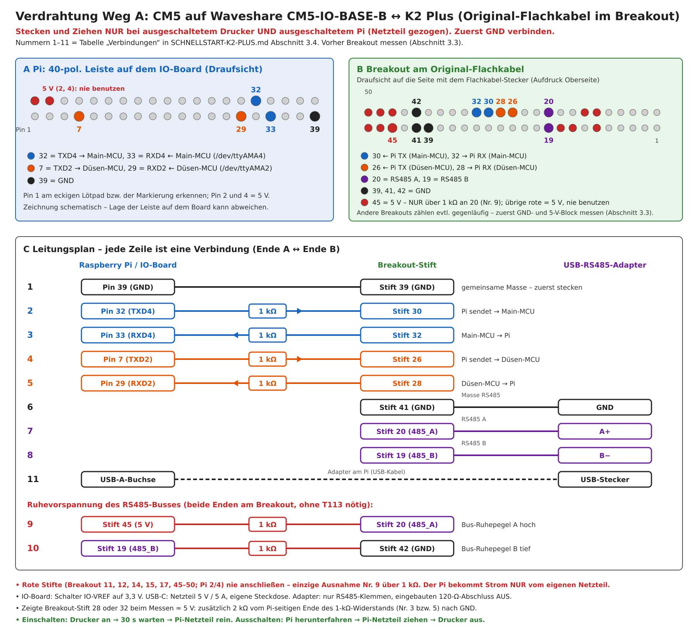

# Schnellstart: Creality K2 Plus mit Upstream-Klipper auf einem Raspberry Pi CM5

> **ALPHA – Stand 24.10.2026 – Nachbau auf eigene Gefahr.**
> Diese Anleitung führt vom unveränderten K2 Plus zu einem K2 Plus, dessen Upper-Board (Allwinner T113 in der
> Display-Einheit) durch einen Raspberry Pi Compute Module 5 (CM5) mit Upstream-Klipper ersetzt ist. Sie fasst die
> Detaildokumente zusammen und verlinkt sie. **Maßgeblich bei Abweichungen sind die verlinkten Dokumente**, vor allem
> der Fahrplan [`PI-INBETRIEBNAHME.md`](PI-INBETRIEBNAHME.md).
> Am echten Gerät bisher an **einem** Drucker erprobt (Stock-Firmware 1.1.7.0). Unsichere Punkte sind mit
> **ANNAHME** bzw. **offen** markiert.

Platzhalter: `<pi-ip>` = Adresse des Pi im Netz, `<drucker-ip>` = Adresse des Original-Druckers (solange das
Original-Upper-Board läuft), `<datum>` = Datum im Paketnamen, `<rs485-adapter>` = by-id-Name des USB-RS485-Adapters.

## Inhalt

0. [Was ist das? Risiken und Haftung](#0-was-ist-das-risiken-und-haftung)
1. [Voraussetzungen](#1-voraussetzungen)
2. [VOR dem Umbau am Original sichern](#2-vor-dem-umbau-am-original-sichern)
3. [Verkabelung (Übergangslösung)](#3-verkabelung-übergangslösung)
4. [Installation](#4-installation)
5. [Erste Inbetriebnahme und Kalibrierung](#5-erste-inbetriebnahme-und-kalibrierung)
6. [Slicer](#6-slicer)
7. [Betrieb](#7-betrieb)
8. [Rückweg zum Original](#8-rückweg-zum-original)
9. [Bekannte Grenzen](#9-bekannte-grenzen)
10. [Weiterführende Dokumente](#10-weiterführende-dokumente)

---

## 0. Was ist das? Risiken und Haftung

**Was getauscht wird:** Nur das Upper-Board (T113). Bridge-Board, Mainboard, Düsen-Platine, Motoren, CFS und
Riemen-Module bleiben im Gerät und behalten ihre Creality-Firmware. Auf dem Pi laufen Upstream-Klipper, Moonraker und
Mainsail sowie unsere Klipper-Module `pi-host/k2_*.py`. Sie bilden die geschlossenen Creality-Teile nach
(Motor-Init, CFS-Box, Kraftsensor-Düse, Riemenspannung, Sicherheitsabschaltungen). Bedient wird über Mainsail im
Browser; das Original-Touchdisplay bleibt ohne Funktion (Abschnitt 9).

**Am Gerät erprobt (22.–23.10.2026, ein Drucker):** Klipper „ready“ mit beiden MCUs, Motor-Init, X/Y-Homing,
Kraftsensor-Antastung, Bett ausrichten und Mesh, PID, Input Shaper, Riemenspannung, CFS-Laden/-Entladen/-Wechsel,
einfarbiger Erstdruck und ein Mehrfarbdruck (Creality-Print-7-Datei, 182 Wechsel, 10 h 28 min, fehlerfrei).
Offen sind u. a. die Punkte in Abschnitt 9 und die offenen Schritte im Fahrplan.

**Risiken:**

- Im Drucker liegen 24 V, auf dem Bridge-Board RS232-Pegel von ±5,5 V. Die Pi-UARTs vertragen höchstens 3,3 V.
  Ein falsch gesteckter Draht kann Pi, MCUs oder Bus-Treiber zerstören.
- Ab der Bewegungsfreigabe kann der Kopf in den Rahmen, die Düse ins Bett fahren. Immer eine Person am
  Netzschalter, Bett leer.
- Die Heizungen gehen **nie automatisch** aus (`[idle_timeout]` wie Stock). Nach jedem Heizschritt
  `TURN_OFF_HEATERS`.
- Der Eingriff kann Garantie- bzw. Gewährleistungsansprüche gegenüber Creality beeinträchtigen.

**Lizenz und Haftung:** Software (z. B. `pi-host/`) unter GPL-3.0-or-later (`LICENSE`). Hardware-Entwürfe in
`hardware/` unter CC BY-NC-SA 4.0, Alpha, nur für Testzwecke. Haftungsausschluss, soweit gesetzlich zulässig:
[`hardware/LIZENZ-UND-HAFTUNG.md`](hardware/LIZENZ-UND-HAFTUNG.md). Es gibt keine Gewährleistung und keinen Support.

**Was der Pi nie tut:** keine Firmware flashen (MCUs, Motoren, CFS, Riemen-Module), keine Motor-Kalibrierung, kein
Löschen der CFS-Datenbank. Der Sendeschutz in den Modulen sperrt diese Befehle. Deshalb ist der Rückweg zum Original
jederzeit möglich (Abschnitt 8). Liste: [`PI-INBETRIEBNAHME.md`](PI-INBETRIEBNAHME.md) §2 Regel 7.

---

## 1. Voraussetzungen

### 1.1 Hardware heute (Übergangslösung „Anschluss-Variante B“)

Der Pi steckt am **Original-Flachkabel** (50-polig, 0,5 mm), das sonst vom Bridge-Board `F008-PC_V15` (Stecker
**J14**) zum T113 führt. Das T113-Ende kommt in ein Breakout; dort speisen die Pi-UARTs die TTL-Seite der beiden
RS232-Wandler auf dem Bridge-Board. Alle übrigen Kabel (J10↔J22, Toolhead-Kabel, 24 V) bleiben original.

| Teil | Wozu | Hinweis |
|---|---|---|
| Raspberry Pi Compute Module 5 mit eMMC | Klipper-Host | WLAN praktisch (Ethernet-Buchse des Druckers ist im Pi-Betrieb tot) |
| IO-Board mit 40-Pol-Standardleiste, bei uns Waveshare **CM5-IO-BASE-B** | GPIO/UART, USB, Flashen | Wahlschalter **IO-VREF auf 3,3 V** (nicht 1,8 V) |
| USB-C-Netzteil **5 V / 5 A** für das IO-Board, eigene Steckdose | Pi-Versorgung | 5 V / 3 A reichte nicht (Unterspannung beim Booten); empfohlen das offizielle 27-W-Netzteil |
| FFC-Breakout 50-polig, 0,5 mm → 2,54 mm, mit Haltenase | Original-Flachkabel aufnehmen | Stiftnummern hier = Aufdruck **Oberseite** (Seite mit dem FFC-Stecker); prüfen, Abschnitt 3.3 |
| Stiftleisten, Steckbrücken Buchse-Buchse | Verdrahtung | Widerstände fest verbinden und isolieren, keine losen Beine |
| Widerstände 1 kΩ, 1/4 W: 4× UART, 2× RS485-Ruhevorspannung | Strombegrenzung, Bus-Ruhepegel | 2 kΩ nur, falls ein UART-Stift 5 V statt 3,3 V zeigt (Abschnitt 3.3) |
| USB-RS485-Adapter, galvanisch getrennt (bei uns Waveshare USB TO RS232/485 (B), FT232RNL) | RS485-Bus: Motoren, CFS, Riemen | nur die RS485-Klemmen, eingebauten 120-Ω-Abschluss **aus** |
| Multimeter | Messen vor dem Stecken | DC-Volt, Ohm, Durchgang |
| Arbeits-PC mit Linux (bash, python3) und einem Klon dieses Repos | Paket bauen (`pack.sh`) | `git clone https://github.com/Gamecard/k2-plus-cm5.git` |

Details und Herleitung: [`PI-ANSCHLUSS-LOWERBOARD.md`](PI-ANSCHLUSS-LOWERBOARD.md) §8 (Bridge-Board, J14-Belegung,
Messprotokoll) und [`PI-INBETRIEBNAHME.md`](PI-INBETRIEBNAHME.md) Phase 0.

### 1.2 Software

- **MainsailOS** (arm64, Debian 13 „trixie“) auf dem eMMC des CM5; geflasht per `rpiboot` über das IO-Board.
  Benutzer `pi`, SSH-Zugang, Pi im WLAN.
- `install.sh` braucht `sudo` **ohne Passwort** für den Benutzer `pi` (prüfen: `sudo -n true` → kein Fehler).
- Klipper: `install.sh` stellt einen älteren Checkout auf den geprüften Upstream-Stand **ee2c6fb** (Abschnitt 4);
  ein **neuerer** Stand, der ee2c6fb enthält, bleibt stehen. Zum PID-Hinweis: Abschnitt 5, Schritt 9.

### 1.3 Künftig: Trägerplatine „K2-CM5-Träger Alpha 1“ (ungetestet)

Ordner [`hardware/k2-pi-cm5-traeger/`](hardware/k2-pi-cm5-traeger/README.md). Der Träger ersetzt das T113 an dessen
Befestigungspunkten und trägt den CM5 direkt (ohne IO-Board). Das Original-Flachkabel steckt dort in einem eigenen
Stecker; Breakout, Steckbrücken und USB-RS485-Adapter entfallen. Geplant sind u. a. Versorgung aus den 24 V des
Druckers, RS485-Treiber auf der Platine, CAN, Anschluss für ein DSI-Display, Kamera-USB und eine
Stromausfall-Erkennung.

**Stand:** Layout fertig, **noch nicht gefertigt und nicht am Drucker geprüft**. Die Software-Anpassungen
(u. a. anderer RS485-Port, CAN, Stromausfall-Wächter) liegen als Paket in
[`pi-host/traeger-alpha1/`](pi-host/traeger-alpha1/README-traeger-alpha1.md) – ebenfalls **am Gerät ungetestet**.
Alpha, CC BY-NC-SA 4.0.

---

## 2. VOR dem Umbau am Original sichern

Solange das Original-Upper-Board noch läuft, diese Daten holen. Sie dienen später als Startwerte für den Pi
(`install.sh`-Optionen, Abschnitt 4). Unsere Dokumente setzen einen funktionierenden SSH-Zugang als `root` am
Original voraus; **wie** er freigeschaltet wird, beschreiben sie nicht.

**Alles nur lokal aufbewahren, nie veröffentlichen:** Die `printer.cfg` enthält Geräte-Kennungen (`[auto_addr]`),
die Box-Daten Kennungen der Creality-Cloud, die Materialdatenbank ist eine Creality-Datei. `pack.sh` bricht ab,
wenn eine dieser Dateien ins Paket geriete.

| Nr. | Was | Pfad am Original | Später |
|---|---|---|---|
| 1 | Kalibrierwerte (SAVE_CONFIG-Block: Schneidposition `cut_pos_x`, Input Shaper, Bett-Mesh) | `/mnt/UDISK/printer_data/config/printer.cfg` | `--stock-printer-cfg` |
| 2 | Materialdatenbank (Temperatur/Geschwindigkeit je Material) | `/mnt/UDISK/creality/userdata/box/material_database.json`, fehlt sie: `/etc/sysConfig/defData/material/material_database.json` | `--material-db` |
| 3 | Material in der Düse (Farbe/Typ) | `/mnt/UDISK/creality/userdata/box/remain_material_data.json` | `--remain-material` |
| 4 | Vollsicherung Config-Ordner und Box-Benutzerdaten | `/mnt/UDISK/printer_data/config/`, `/mnt/UDISK/creality/userdata/box/` | nur Archiv |

1. Am Arbeits-PC einen leeren Ordner anlegen und die Dateien holen:

   ```bash
   scp root@<drucker-ip>:/mnt/UDISK/printer_data/config/printer.cfg stock-printer.cfg
   scp root@<drucker-ip>:/mnt/UDISK/creality/userdata/box/material_database.json .
   scp root@<drucker-ip>:/mnt/UDISK/creality/userdata/box/remain_material_data.json .
   scp -r root@<drucker-ip>:/mnt/UDISK/printer_data/config stock-config
   scp -r root@<drucker-ip>:/mnt/UDISK/creality/userdata/box stock-box
   ```

2. `remain_material_data.json` **unmittelbar vor dem Umbau** holen (nach dem letzten Druck oder Materialwechsel am
   Original), sonst stimmt das Düsenmaterial nicht. Fehlt die Datei, spült der erste Wechsel am Pi pauschal.
3. **Stock-Firmware:** Sie liegt auf dem T113-Board und wird beim Umbau **nicht** verändert – es wird nur das
   Flachkabel umgesteckt, nichts geflasht. T113, Display und alle Kabel aufbewahren (Rückweg, Abschnitt 8).
   Firmware-Stand notieren; erprobt ist nur **1.1.7.0** (MCU-Firmware `1.1.0.48-293-g493f9a0f`). Andere Stände sind
   ungeprüft.
4. Fotos machen: Lage und **Kontaktseite** des Flachkabels an J14 (Bridge-Board) und am T113-Stecker.
5. Optional, aber empfohlen, solange das Original läuft (Fahrplan 0.4 „B2“): Versorgung der beiden RS232-Wandler
   U6/U7 auf dem Bridge-Board messen. Pin 15 (GND) liegt direkt neben Pin 16 – nicht abrutschen. Pin 2/6
   (Ladungspumpe) und die RS232-Pins 14/7/13/8 nicht berühren.

   Messart: **Gleichspannung (DC-Volt)**, Drucker an, Original läuft.

   | Messung | **rote** Spitze an | **schwarze** Spitze an | erwartet |
   |---|---|---|---|
   | Versorgung U6 | U6 Pin 16 | Testpunkt „GND“ neben J14 | ≈ 3,3 V oder ≈ 5 V (notieren) |
   | Versorgung U7 | U7 Pin 16 | Testpunkt „GND“ neben J14 | ≈ 3,3 V oder ≈ 5 V (notieren) |

   Bei ≈ 5 V braucht die RX-Leitung dieses Wandlers zusätzlich 2 kΩ nach GND (Abschnitt 3.4). Ausschlaggebend ist die
   Messung am Breakout in Abschnitt 3.3.

---

## 3. Verkabelung (Übergangslösung)

Ausführlich mit allen Begründungen: [`PI-INBETRIEBNAHME.md`](PI-INBETRIEBNAHME.md) Phase 0 (Schritte 0.3–0.11),
Messprotokoll und bestätigte Belegung: [`PI-ANSCHLUSS-LOWERBOARD.md`](PI-ANSCHLUSS-LOWERBOARD.md) §8.6.

**Regeln (immer):**

- Stecken und Ziehen nur bei ausgeschaltetem Drucker **und** ausgeschaltetem Pi. GND zuerst verbinden.
- T113 und Pi **nie gleichzeitig** am Flachkabel.
- **5-V-Stifte des Breakouts (45–50) nie an den Pi.** Der Pi hat sein eigenes Netzteil.
- In jede UART-Leitung 1 kΩ in Reihe.
- Nie RS232-Leitungen an Pi-Pins (J22, Testpads TX7/RX7/TX1/RX1, U6/U7 Pin 14/7/13/8): dort liegen ±5,5 V.
- Kein USB-A↔USB-A-Kabel zwischen Pi und Bridge-Board; J22 Pin 12 (+5,2 V) nie anschließen.
- Flachkabel nur bei geöffnetem Klappbügel bewegen, nicht knicken, Halteohren nicht abschneiden, Original-Kabel nie
  zerschneiden.

### 3.1 Pi-UARTs einschalten (Pi allein, nicht am Drucker)

1. In `/boot/firmware/config.txt` ganz am Ende, nach einer Zeile `[all]`, zwei Zeilen eintragen:

   ```
   dtoverlay=uart2-pi5
   dtoverlay=uart4-pi5
   ```

   Ohne Parameter `ctsrts`. **Falle:** Eine Kommentarzeile länger als etwa 80 Zeichen davor ließ die folgende
   `dtoverlay`-Zeile verschwinden – kurze Zeilen verwenden.
2. `sudo reboot`, danach prüfen: `ls -l /dev/ttyAMA*` zeigt `/dev/ttyAMA2` und `/dev/ttyAMA4`;
   `pinctrl get 4,5,12,13` zeigt `TXD2`/`RXD2`/`TXD4`/`RXD4`; keines der beiden Geräte steht in `/proc/cmdline` als
   `console=`.
3. Pegel der Pi-Seite prüfen (IO-VREF).

   Messart: **Gleichspannung (DC-Volt)**, Pi an, nichts am Header angeschlossen.

   | Messung | **rote** Spitze an | **schwarze** Spitze an | erwartet |
   |---|---|---|---|
   | UART2-TX Ruhepegel | Pi-Header Pin 7 | Pi-Header Pin 39 (GND) | ≈ 3,3 V (nicht 1,8 V) |
   | UART4-TX Ruhepegel | Pi-Header Pin 32 | Pi-Header Pin 39 (GND) | ≈ 3,3 V (nicht 1,8 V) |

### 3.2 Breakout an das Original-Flachkabel stecken (stromlos)

1. Pi herunterfahren, Pi-Netzteil ziehen. Drucker am Netzschalter aus, Netzstecker ziehen.
2. Display-Einheit öffnen. Am T113-Board den Klappbügel des Flachkabel-Steckers öffnen und das Kabel herausziehen.
   Das andere Ende bleibt in J14 am Bridge-Board. Das Display-Kabel des T113 bleibt am T113.
3. Das freie Kabelende mit **derselben Kontaktseite wie am T113** (Foto aus Abschnitt 2) ins Breakout schieben,
   Haltenase einrasten lassen, Bügel schließen.
4. Breakout isoliert ablegen (keine Stifte auf Metall).

### 3.3 Breakout prüfen, bevor etwas am Pi hängt

Die Stiftnummern unten gelten für die **Oberseite** unseres Breakouts. Andere Breakouts können gegenläufig zählen
(dann gilt: Nummer oben = 51 − Nummer unten). Deshalb zuerst die Blöcke GND und 5 V bestätigen.

Messart: **Widerstand (Ω)**, Drucker aus und Netzstecker gezogen, am Breakout hängt nichts.

| Messung | **rote** Spitze an | **schwarze** Spitze an | erwartet |
|---|---|---|---|
| GND-Block | Breakout-Stift 39 (dann 40, 41, 42, 43, 44) | Testpunkt „GND“ neben J14 | ≈ 0 Ω |
| 5-V-Block | Breakout-Stift 45 (dann 46 … 50) | Testpunkt „5V“ auf dem Bridge-Board | ≈ 0 Ω |

Stift 46 piepst im Durchgangstest auch gegen GND (≈ 15 Ω Last der 5-V-Schiene) – er ist 5 V, nie als GND verwenden.

Messart: **Gleichspannung (DC-Volt)**, Netzstecker rein, Drucker an, T113 abgesteckt, am Breakout hängt nichts.
Danach Drucker wieder aus.

| Messung | **rote** Spitze an | **schwarze** Spitze an | erwartet |
|---|---|---|---|
| Main-MCU → Pi (RX) | Breakout-Stift 32 | Breakout-Stift 39 | ≈ 3,3 V |
| Düsen-MCU → Pi (RX) | Breakout-Stift 28 | Breakout-Stift 39 | ≈ 3,3 V |
| Pi → Main-MCU (TX) | Breakout-Stift 30 | Breakout-Stift 39 | ≈ 0,1–0,2 V (offen) |
| Pi → Düsen-MCU (TX) | Breakout-Stift 26 | Breakout-Stift 39 | ≈ 0,1–0,2 V (offen) |
| 5 V (nur zur Kontrolle) | Breakout-Stift 45 | Breakout-Stift 39 | ≈ 5 V |
| RS485 A | Breakout-Stift 20 | Breakout-Stift 39 | ≈ 1,8 V |
| RS485 B | Breakout-Stift 19 | Breakout-Stift 39 | ≈ 1,7 V |

- Zeigt Stift 28 oder 32 **≈ 5 V**: für diese Leitung zusätzlich 2 kΩ nach GND vorsehen (Abschnitt 3.4).
- **Negativ oder über 5,5 V an einem Daten-Stift** (RS232-Seite erwischt): STOP, nichts anschließen, klären.

### 3.4 Verbindungen

Reihenfolge beim Stecken: zuerst GND, dann die Datenleitungen. Drucker und Pi aus.

Übersicht als Bild (Lage der Stifte auf Pi-Leiste und Breakout, Nummern wie in der Tabelle; Quelle
[`bilder/verdrahtung-weg-a.svg`](bilder/verdrahtung-weg-a.svg)):



| Nr. | Ende A | dazwischen | Ende B | Zweck |
|---|---|---|---|---|
| 1 | Pi-Header Pin 39 (GND) | – | Breakout-Stift 39 (GND) | gemeinsame Masse |
| 2 | Pi-Header Pin 32 (GPIO 12, TXD4) | 1 kΩ | Breakout-Stift 30 | Pi sendet → **Main-MCU** (`/dev/ttyAMA4`) |
| 3 | Breakout-Stift 32 | 1 kΩ | Pi-Header Pin 33 (GPIO 13, RXD4) | Main-MCU → Pi |
| 4 | Pi-Header Pin 7 (GPIO 4, TXD2) | 1 kΩ | Breakout-Stift 26 | Pi sendet → **Düsen-MCU** (`/dev/ttyAMA2`) |
| 5 | Breakout-Stift 28 | 1 kΩ | Pi-Header Pin 29 (GPIO 5, RXD2) | Düsen-MCU → Pi |
| 6 | USB-RS485-Adapter GND | – | Breakout-Stift 41 (GND) | Masse RS485 |
| 7 | USB-RS485-Adapter A+ | – | Breakout-Stift 20 (485_A) | RS485 A |
| 8 | USB-RS485-Adapter B− | – | Breakout-Stift 19 (485_B) | RS485 B |
| 9 | Breakout-Stift 45 (5 V) | 1 kΩ (Ruhevorspannung) | Breakout-Stift 20 (485_A) | Bus-Ruhepegel A hoch |
| 10 | Breakout-Stift 19 (485_B) | 1 kΩ (Ruhevorspannung) | Breakout-Stift 42 (GND) | Bus-Ruhepegel B tief |
| 11 | USB-RS485-Adapter USB | – | USB-Buchse des IO-Boards | Adapter am Pi |

Nur falls Stift 28 bzw. 32 in Abschnitt 3.3 ≈ 5 V zeigte: zusätzlich 2 kΩ vom **Pi-seitigen** Ende des 1-kΩ-
Widerstands (Nr. 3 bzw. 5) nach GND (5 V × 2/3 ≈ 3,3 V).

Hinweise:

- Die Zuordnung „UART4 = Main-MCU, UART2 = Düsen-MCU“ ist am 22.10.2026 per Identify bestätigt. Ältere Stellen im
  Fahrplan nennen es umgekehrt – die Messung gilt.
- Der Ruhevorspannung (Nr. 9/10) liegt eine Messung zugrunde: Ohne T113 fehlt sie auf dem Bus (A−B nur ≈ 0,16 V,
  unter der Empfängerschwelle von 0,2 V); mit 2 × 1 kΩ gemessen 0,445 V. Der eingebaute 120-Ω-Abschluss des Adapters
  bleibt aus (auf dem Bus sitzt schon ein Abschluss).
- **Frei lassen:** 5-V-Stifte 45–50 (außer Nr. 9), 5-V-Signale 11, 12, 14, 15, 17, Stift 9 (SD), Ethernet 1/2 und
  4/5, Hub-USB 34/35, Kamera-USB 37/38, unbekannte Stifte 7, 8, 22, 24.

### 3.5 Prüfen vor dem ersten Einschalten

Messart: **Widerstand (Ω)**, Drucker aus (Netzstecker gezogen), Pi aus (Netzteil gezogen), alles verdrahtet.

| Messung | **rote** Spitze an | **schwarze** Spitze an | erwartet |
|---|---|---|---|
| Main TX | Pi-Header Pin 32 | Breakout-Stift 30 | ≈ 1 kΩ |
| Main RX | Breakout-Stift 32 | Pi-Header Pin 33 | ≈ 1 kΩ |
| Düse TX | Pi-Header Pin 7 | Breakout-Stift 26 | ≈ 1 kΩ |
| Düse RX | Breakout-Stift 28 | Pi-Header Pin 29 | ≈ 1 kΩ |
| Masse | Pi-Header Pin 39 | Breakout-Stift 39 | ≈ 0 Ω |
| kein 5 V am Pi | Pi-Header Pin 7, 29, 32, 33 (nacheinander) | Breakout-Stift 45 | kein Durchgang (deutlich mehr als 1 kΩ, „OL“) |

### 3.6 Ein- und Ausschalten (Reihenfolge)

**Einschalten:**

1. Drucker am Netzschalter einschalten.
2. Etwa 30 s warten. Main- und Düsen-MCU springen ohne T113 selbst in ihre Anwendung; die CFS braucht ihr
   Bootloader-Fenster von rund 30 s.
3. Pi-Netzteil einstecken.

**Ausschalten:**

1. Druck beendet, Heizungen aus (`TURN_OFF_HEATERS`).
2. Pi herunterfahren (Mainsail → Herunterfahren, oder `sudo poweroff`), warten, bis er aus ist.
3. Pi-Netzteil ziehen.
4. Drucker am Netzschalter ausschalten.

**Kaltstart** (z. B. wenn Motoren nach vielen Klipper-Neustarts Aussetzer zeigen):

1. Pi herunterfahren.
2. Pi-Netzteil ziehen.
3. Drucker ausschalten.
4. 30 s warten.
5. Drucker einschalten.
6. 30 s warten.
7. Pi-Netzteil einstecken.

Den Pi nicht lange laufen lassen, während der Drucker aus ist: Seine TX-Leitungen liegen dann an den Eingängen der
stromlosen Wandler (Rückspeisung, **offen**; die 1-kΩ-Widerstände begrenzen den Strom). Für den Fall, dass der
Drucker doch bei laufendem Pi aus- und wieder eingeschaltet wird, gibt es den Start-Wächter (Abschnitt 7).

**Rückfallweg Variante A** (RS232-Konverter an J22 und am Toolhead-Kabel statt Breakout): nur, wenn Variante B
scheitert; am Gerät nie gelaufen. [`PI-INBETRIEBNAHME.md`](PI-INBETRIEBNAHME.md) Anhang E.

---

## 4. Installation

Alle Einzelheiten: [`pi-host/install/README.md`](pi-host/install/README.md). Die Installation kann schon vor der
Verkabelung laufen (Fahrplan 0.2); Klipper bleibt dabei gestoppt.

### 4.1 Paket bauen (Arbeits-PC)

```bash
pi-host/install/pack.sh --tests      # baut k2-pi-paket-<datum>.tar.gz (+ .sha256), vorher alle Offline-Tests
```

Voraussetzungen und Ausgabeordner: install-README §2. Die beiden MCU-Dictionaries für den Batch-Test stammen aus der
Creality-Firmware und liegen **nicht** im Repo: mit `--dicts ORDNER` angeben, sonst `pack.sh --tests --ohne-dicts`
(dann überspringt `install.sh` die Batch-Prüfung, einige Tests melden SKIP). Das Paket enthält **nie**
Materialdatenbank, `remain_material`, Stock-`printer.cfg` oder Zugangsdaten.

### 4.2 Auf den Pi und installieren (als Benutzer `pi`, nicht root)

```bash
scp k2-pi-paket-<datum>.tar.gz pi@<pi-ip>:~
ssh pi@<pi-ip>
tar xzf k2-pi-paket-<datum>.tar.gz
cd k2-pi-paket-<datum>
./install.sh --printer-cfg-ersetzen --bewegung-gesperrt \
  --material-db material_database.json \
  --remain-material remain_material_data.json \
  --stock-printer-cfg stock-printer.cfg
```

Die drei Dateien aus Abschnitt 2 vorher in den Paketordner kopieren (oder mit Pfad angeben). `install.sh` prüft sie
**vor** jeder Änderung und bricht bei kaputten Dateien ab, ohne etwas zu verändern.

Was `install.sh` tut (kurz): Prüfsummen und Umgebung prüfen → Sicherung nach `~/k2-pi-backup/<stamp>/` →
Klipper-Checkout auf `ee2c6fb` (nur wenn sauber; ein neuerer Stand bleibt) → Klipper stoppen → Module nach `~/klipper/klippy/extras/` →
Config nach `~/printer_data/config/` → Offline-Tests und Batch-Prüfung → Dienste/Web-Anpassungen → Zusammenfassung.
Mehrfach aufrufbar; eingetragene serial-Pfade, von Hand gesetzte Schutzschalter (`allow_write`/`allow_move`,
`[k2_motor] auto_init`/`stall_monitor`, Abschnitt 5) und der SAVE_CONFIG-Block (Kalibrierung) bleiben bei Wiederholung erhalten. Andere Handänderungen an
den mitgelieferten cfg-Dateien ersetzt ein neuer Lauf durch den Paketstand (alte Datei im Backup).

**Wichtige Optionen:**

| Option | Wirkung |
|---|---|
| `--printer-cfg-ersetzen` | vorhandene `printer.cfg` ersetzen (sonst liegt die K2-Datei als `printer-k2.cfg` daneben) |
| `--main-serial PFAD\|auto` | Port der Main-MCU → `[mcu] serial` |
| `--duese-serial PFAD\|auto` | Port der Düsen-MCU → `[mcu nozzle_mcu] serial` |
| `--rs485-serial PFAD` | Port des USB-RS485-Adapters → `[k2_485] serial` |
| `--serial-erkennen` | MCU-Erkennung nur anzeigen, nichts eintragen |
| `--material-db DATEI` | Materialdatenbank nach `~/printer_data/config/k2/material_database.json` |
| `--remain-material DATEI` | Material in der Düse als Startwert (nur beim Umstieg sinnvoll) |
| `--stock-printer-cfg DATEI` | Kalibrierwerte der Original-`printer.cfg` übernehmen (`cut_pos_x`, Input Shaper, Mesh-Profile; nie `[auto_addr]`) |
| `--stock-ueberschreiben` | mit `--stock-printer-cfg`: abweichende Pi-Werte durch die Stock-Werte ersetzen |
| `--bewegung-gesperrt` | `_PI_FREIGABE allow_move: False` setzen (G28/Bewegung gesperrt) – für die **Erstinbetriebnahme** empfohlen, das Paket liefert `True` |
| `--klipper-auf-zielstand` | auch einen neueren Klipper-Stand auf `ee2c6fb` zurückstellen (Rückschritt, normalerweise nicht nötig) |
| `--starten` | Klipper am Ende starten (sonst bleibt er gestoppt) |
| `--ohne-startwaechter` | Start-Wächter **nicht** einrichten (Standard: an) |
| `--ohne-creality-bruecke` | Creality-Brücke samt nginx-Block **nicht** einrichten (Standard: an) |
| `--ohne-moonraker-anpassung` | Moonraker-Einstellung `enable_api_key` **nicht** ändern (Standard: an) |

**Dienste und Web-Anpassungen (Standard an, einzeln abschaltbar, idempotent, gesichert):**

- **Start-Wächter** (`k2-startwaechter.service`, Programm in `~/k2-tools/`): löst selbst einen `FIRMWARE_RESTART`
  aus, wenn der Drucker nach dem Pi eingeschaltet oder bei laufendem Pi aus- und wieder eingeschaltet wurde – nie bei
  einer Sicherheitsabschaltung und nie bei laufendem oder pausiertem Druck. Verhalten: Abschnitt 7.1.
- **Creality-Brücke** (`k2-creality-bruecke.service`, läuft mit `~/moonraker-env/bin/python`) und ein nginx-Block
  `location ~ ^/upload/` im Mainsail-Server: für OrcaSlicer-Profile, die den „CrealityPrint“-Agenten benutzen
  (Abschnitt 6.2).
- **Moonraker:** `[authorization] enable_api_key: False`. Sonst lehnt Moonraker 0.11 OrcaSlicer mit
  `401 Invalid API Key` ab.

Diese drei Teile sind am echten Pi **von Hand** eingerichtet und dort in Betrieb; der automatische Weg über
`install.sh` ist nur in einer Attrappe (Fake-HOME, Fake-`systemctl`) geprüft.

### 4.3 MCUs erkennen und Ports eintragen (nach der Verkabelung)

Drucker und Pi in der Reihenfolge aus Abschnitt 3.6 einschalten, dann:

1. `sudo systemctl stop klipper` (sonst sind die Ports belegt).
2. Erkennung, **immer mit ausdrücklichen Ports** (ohne Angabe fragt das Werkzeug nur `/dev/serial/by-id/*` ab und
   könnte Identify-Bytes auf den RS485-Bus schicken):

   ```bash
   ~/klippy-env/bin/python ./k2-identify.py /dev/ttyAMA4 /dev/ttyAMA2
   ```

   Erwartet: `/dev/ttyAMA4` → „Main-MCU“ (`gd32f303xe`), `/dev/ttyAMA2` → „Düsen-MCU“ (`gd32f303xb`), je 230400 Baud,
   Version `1.1.0.48-293-g493f9a0f`. Nur `identify` wird gesendet. Keine Antwort → Verdrahtung prüfen (Abschnitt
   3.5), **nicht** blind TX/RX tauschen; ist das Toolhead-Kabel gesteckt? (Ohne es schweigt die Düsen-MCU.)
3. Ports eintragen – mit Pfad, **nicht** `auto` (`auto` sucht nur unter `/dev/serial/by-id`):

   ```bash
   ls -l /dev/serial/by-id/                    # Name des RS485-Adapters ablesen
   ./install.sh --printer-cfg-ersetzen --main-serial /dev/ttyAMA4 --duese-serial /dev/ttyAMA2 \
     --rs485-serial /dev/serial/by-id/<rs485-adapter>
   ```

   Die `ttyAMA`-Namen hängen am Device-Tree (Overlays), nicht an der USB-Reihenfolge – deshalb ohne by-id
   (ältere Pakete zeigten dazu noch einen Hinweis „… kein /dev/serial/by-id/-Pfad“).
4. `sudo systemctl start klipper`, in Mainsail (`http://<pi-ip>`) sofort `FIRMWARE_RESTART`.
   Regel: **nach jedem Neustart des Klipper-Dienstes `FIRMWARE_RESTART`**, sonst bleibt der Extruder-Motor stumm
   (Fehler key798).
5. Erwartet im `klippy.log`: „Klipper ready“, `Loaded MCU 'mcu' … 1.1.0.48-293-g493f9a0f` und dasselbe für
   `nozzle_mcu`, kein „format mismatch“.

### 4.4 Was `install.sh` nicht übernimmt

- Pi-Grundeinrichtung (MainsailOS, SSH, `sudo`) und die UART-Overlays (Abschnitt 1.2, 3.1).
- Mainsail-Einstellungen: empfohlen „Not-Aus bestätigen“ und „Druck abbrechen bestätigen“ einschalten (am Handy wurde
  zweimal versehentlich abgebrochen).
- Slicer-Profil (Abschnitt 6), Kalibrierung und Schutzschalter (Abschnitt 5).

### 4.5 Pi-Software zurückbauen

```bash
./uninstall.sh              # letzter Lauf (~/k2-pi-backup/letzte), mit Rückfrage
./uninstall.sh --aelteste   # Zustand vor der ERSTEN Installation
```

Einzelheiten: install-README §5.

---

## 5. Erste Inbetriebnahme und Kalibrierung

Maßgeblich ist der Fahrplan [`PI-INBETRIEBNAHME.md`](PI-INBETRIEBNAHME.md) (Phasen 1–12, jeweils mit „Erwartet“ und
„Abbruch → tun“). Hier die Kurzfassung in der Reihenfolge, in der sie bei uns funktioniert hat.

**Regeln:**

- Eine Person am Netzschalter, Bett leer, nichts im Fahrweg. Jeder Schritt mit Bewegung einzeln.
- Nach jedem Schritt `klippy.log` bzw. Mainsail-Konsole prüfen (Shutdown, Timeouts, Config-Fehler).
- Not-Aus-Stufen: Netzschalter → `M112` → nach harmlosem Fehler `FIRMWARE_RESTART`.
- `SAVE_CONFIG` startet Klipper neu: Motoren werden stromlos, das Bett sackt ungleich ab → danach
  `Z_AXIS_CALIBRATION` (bzw. `START_PRINT` gleicht selbst aus).

**Schutzschalter.** Die Module sind so ausgeliefert, dass Bus-Schreiben und Bewegung erst nach ausdrücklicher Freigabe
möglich sind. Jeder Schalter wird in der Phase umgestellt, in der er gebraucht wird (Fahrplan §3); nach jeder
Config-Änderung `FIRMWARE_RESTART`. Von Hand gesetzte Werte dieser Schalter übernimmt `install.sh` bei jedem weiteren
Lauf (Meldung „… <- True (bisherige Datei …)“).

| Schalter | Datei | Lieferzustand | auf `True` ab |
|---|---|---|---|
| `[k2_motor] allow_write` | `k2-motor.cfg` | `False` | Schritt 3 (Motor-Init), bleibt dann `True` (auch für X/Y-Homing nötig) |
| `[k2_motor] auto_init` | `k2-motor.cfg` | `False` | Schritt 3, bleibt `True` |
| `_PI_FREIGABE` `variable_allow_move` | `homing.cfg` | `True` (Stand nach unserer abgeschlossenen Inbetriebnahme) | für die **Erstinbetriebnahme** `install.sh --bewegung-gesperrt` (setzt `False`), dann je Sitzung `ALLOW_MOTION`; nach der Inbetriebnahme von Hand `True` |
| `[k2_prtouch] allow_move` | `printer.cfg` | `False` | Schritt 5 (Z-Antasten), bleibt `True` |
| `[k2_box] allow_write` / `allow_move` | `k2-module.cfg` | `False` | Schritt 3 (nur CFS-Adresse) bzw. Schritt 14 (CFS) |
| `[k2_belt mdlx]`/`[k2_belt mdly]` `allow_write` + `allow_move` | `k2-module.cfg` | `True` (für `BELT_TENSION`) | – |
| `[k2_motor] stall_monitor` | `k2-motor.cfg` | `report` | `act` erst nach Fahrplan 12.8 |

**Schritte:**

1. **Grundprüfung ohne Bewegung** (Fahrplan 1.4–1.8): Temperaturen ≈ Raumtemperatur; `QUERY_ENDSTOPS` (x/y/z
   „open“); `QUERY_PROBE` („open“); `M106 P0 S128`, dann `M107` (Bauteillüfter); `ZALIGN_STATUS`;
   `KTWO_SAFETY_STATUS` (Grenzen Düse 350 / Bett 120 / Kammer 60 °C).
2. **Busse lesend** (Phase 2): `KTWO_BUS_STATUS` (`offen=True`, ohne Timeouts/CRC-Fehler); `KTWO_BOX_STATUS`;
   `KTWO_MOTOR_STATUS`; `KTWO_BELT_INFO MDL_NAME=mdlx` und `… mdly`. Port offen, aber alles stumm → A/B vertauscht
   (Drucker aus, tauschen). Dass die Motoren vor dem Init schweigen, ist normal.
3. **Motor-Init** (Phase 3): `KTWO_MOTOR_INIT DRY_RUN=1` (nur Plan) → `[k2_motor] allow_write: True`,
   `FIRMWARE_RESTART` → `KTWO_MOTOR_INIT` (erwartet: alle 5 Motoren bereit) → `auto_init: True` und Kaltstart
   (Abschnitt 3.6): Der Init läuft dann bei jedem Start von selbst. CFS-Adresse: Fahrplan 3.6 (kurz
   `[k2_box] allow_write: True`).
4. **Freigabe:** `ALLOW_MOTION` (gilt bis zum nächsten Neustart).
5. **Homing-Test X/Y** (Phase 4): `G28 Y`, dann `G28 X` einzeln, Hand am Netzschalter. Bei uns fährt Y nach vorne,
   X nach rechts. `KTWO_LIMITS_STATUS`. Danach Schneidposition – **ohne Filament im Kopf** – `CALIBRATE_CUT_POS SAVE=1`
   (Ergebnis nahe dem Stock-Wert, bei uns −7,80).
6. **Z mit Kraftsensor** (Phase 5): `[k2_prtouch] allow_move: True`, `FIRMWARE_RESTART`. Erste Antastung genau nach
   Fahrplan 5.2 (festgelegtes Verfahren mit Bett ganz unten), dann `PROBE_ACCURACY SAMPLES=5`, dann vollständiges
   `G28`.
7. **Bett ausrichten:** `Z_AXIS_CALIBRATION` (`G28` + `Z_TILT_ADJUST` + `G28 Z`, Standard warm mit 50 °C Bett); kalt mit `Z_AXIS_CALIBRATION BED_TEMP=0`.
8. **Düsen-PID:** `NOZZLE_PID` (Standard `TEMP=220`, `FAN=0` = Bauteil- und Seitenlüfter aus; Kopf über dem
   Abfallschacht). Die Werte sind danach **noch nicht aktiv**:
   - prüfen: `SET_HEATER_PID HEATER=extruder KP=… KI=… KD=…` und `HEATER_STABILITY_TEST` (120 s bei 220 °C, „ruhig“ bei
     höchstens 1 °C Abweichung);
   - speichern: `SET_HEATER_PID HEATER=extruder KP=… KI=… KD=… SAVE=1`, dann `SAVE_CONFIG`.
   - Für Temperaturen ab 280 °C optional `NOZZLE_PID_HIGH` (Standard 300 °C; über 260 °C nur mit leerer Düse oder
     `FILAMENT_OK=1`), geprüft mit `SET_HEATER_PID … SET=HIGH`.
9. **Hinweis zur PID-Formel:** Klipper rechnete in `PID_CALIBRATE` mit voller statt halber Heizleistung (Ku-Formel);
   behoben im Upstream-Commit `e761a2c76`. Der vom Paket geprüfte Stand `ee2c6fb` enthält den Fix
   (vorher, mit älterem Klipper, fielen die Werte etwa doppelt so scharf aus – bei uns ±2 °C Dauerschwingung). Wer Klipper selbst aktualisiert, lässt
   danach `install.sh` erneut laufen (Schritt 6 prüft die Module gegen den neuen Stand). Darum nie ungeprüft
   speichern. Vergleich bei uns: mit korrigierter Formel
   9,773 / 0,931 / 25,654; vorher von Hand gefunden 10 / 0,8 / 40 (beide ruhig).
10. **Bett-PID:** `BEDPID` (Standard 100 °C, ≈ 10 min), dann `SAVE_CONFIG`, danach `Z_AXIS_CALIBRATION`.
11. **Mesh:** `G29` (Düse 140 °C, Bett 50 °C, Homing, Ausrichten, Reinigung, `BED_MESH_CALIBRATE PROFILE=default`,
    Heizungen aus), dann `SAVE_CONFIG`, danach `Z_AXIS_CALIBRATION`.
12. **Input Shaper** (Phase 8, Beschleunigungssensor in der Düse):
    - Sensor prüfen: `ACCELEROMETER_DEBUG_READ REG=0x0f` (Chip-ID 0x44), `KTWO_ACCEL_STATUS`, `ACCELEROMETER_QUERY`.
      Die Messrate liegt bei ≈ 625 Werten/s (mehr gibt die Düsen-Firmware nicht her; reicht für den Shaper):
      [`pi-host/README-k2_lis2dw.md`](pi-host/README-k2_lis2dw.md) §7/§9.
    - `SHAPER_CALIBRATE`, dann `SAVE_CONFIG`. Bei uns: X `3hump_ei` 89 Hz, Y `mzv` 40 Hz.
    - Ausschalten bis zum Neustart: `TUNOFFINPUTSHAPER`.
13. **Riemen spannen** (Phase 10): `BELT_TENSION` (Standard `AXES=XY`). Der Kopf fährt nach hinten (X225/Y345) und
    schüttelt die Riemen zweimal durch; Sollbereich 119–161 N, Ziel 140 N. Danach sind die Motoren aus.
    Details: [`pi-host/README-k2_belt.md`](pi-host/README-k2_belt.md).
14. **Erster Druck, einfarbig** (Fahrplan 12.1): Datei mit `START_PRINT EXTRUDER_TEMP=… BED_TEMP=…` aus Mainsail
    starten. Erwartet: Heizen auf 140 °C, Homing, ggf. `Z_TILT_ADJUST`, Reinigung, Mesh, Drucktemperatur.
15. **CFS und Mehrfarbe** (Phase 9, 12.2/12.3): `[k2_box] allow_write: True` und `allow_move: True`,
    `FIRMWARE_RESTART`.
    - Erst lesen: `KTWO_BOX_STATUS`.
    - Fächer einzeln bei 220 °C: `KTWO_BOX_EXTRUDE TNN=T1A` (laden), `KTWO_BOX_RETRUDE SLOT=A` (entladen); B, C, D
      ebenso.
    - Ganze Wechsel außerhalb eines Drucks: `T1`, `T0`, `T1`.
    - Danach Mehrfarbdruck.
    - Externe Spule (Rack hinten): `SET_FILAMENT_SOURCE SOURCE=EXTERNAL`, `LOAD_FILAMENT`, `UNLOAD_FILAMENT`, zurück mit `SET_FILAMENT_SOURCE SOURCE=CFS`
      (Fahrplan 9.8).
    - Details: [`pi-host/README-k2_box.md`](pi-host/README-k2_box.md).

Zuletzt `ZALIGN`/Dual-Z (Phase 11) und die Druckfälle PAUSE/RESUME, Abbruch, Restmaterial, Stall-Überwachung
(Phase 12.4–12.8) – laut Fahrplan teils noch offen.

---

## 6. Slicer

### 6.1 OrcaSlicer mit Moonraker (Hauptweg)

1. Druckerprofil auf Basis des System-Profils **„Creality K2 Plus 0.4 nozzle“** anlegen (kopieren bzw. davon erben,
   z. B. Name „Creality K2 Plus 0.4 nozzle - Pi“). Der Startcode des Profils ruft `START_PRINT EXTRUDER_TEMP=…
   BED_TEMP=…` auf – so lassen.
2. Im Prozessprofil **„Objekte beschriften“** (Label objects) einschalten: `START_PRINT` misst standardmäßig ein Mesh
   nur über den Objekten (`ADAPTIVE=1`, Profil `adaptiv`; ohne Objekte misst Klipper das ganze Bett). `ADAPTIVE=0`
   lädt stattdessen das gespeicherte Profil `default`.
3. Physischer Drucker: Host-Typ **„Octo/Klipper“** (neuere Orca-Versionen: „Moonraker“), Host `<pi-ip>:7125`
   (Moonraker direkt) oder `<pi-ip>` (Port 80 über nginx). Beide Wege antworteten bei uns (Moonraker emuliert die
   OctoPrint-Schnittstelle).
4. Druckeragent: Ein Profil, das vom Creality-K2-Profil erbt, nimmt ohne eigene Angabe den **CrealityPrint**-Agenten.
   Für Moonraker den Agenten „moonraker“ wählen (bei uns OrcaSlicer 2.5.0-alpha). Bleibt es beim CrealityPrint-Agenten,
   greift die Creality-Brücke (6.2).
5. Kommt `401 Invalid API Key`: Moonraker-Einstellung `enable_api_key: False` fehlt (Abschnitt 4.2).

Mehrfarbdateien aus Orca (`T<n>`) sind außerhalb eines Drucks erprobt (`T1`/`T0`/`T1`); ein ganzer
Orca-Mehrfarbdruck am Pi ist laut Fahrplan 12.3 noch **offen**.

### 6.2 OrcaSlicer mit dem CrealityPrint-Agenten (über die Creality-Brücke)

Für Profile, die den Creality-Agenten benutzen (Host-Typ CrealityPrint, Host `<pi-ip>` ohne Port):

1. `GET http://<pi-ip>/info` – Antwort darf fehlen.
2. `POST http://<pi-ip>/upload/<datei>` – nginx leitet an Moonraker (`/server/files/upload`) weiter.
3. WebSocket `ws://<pi-ip>:9999/` mit `opGcodeFile` bzw. `multiColorPrint` – die Brücke startet die Datei über
   Moonraker, also über `SDCARD_PRINT_FILE` samt Dateiprüfung.

Die Brücke macht **nur den Druckstart**: kein Abbruch, keine Box-Befehle; `colorMatch` wird quittiert und
ignoriert (die Farbzuordnung steht in der Datei). Log: `journalctl -u k2-creality-bruecke`.

### 6.3 Creality Print

- G-Code exportieren und in Mainsail hochladen, dort starten.
- Mehrfarbdateien aus **Creality Print 7** (Wechselkette `M8200 P … R … L … O`) sind am Pi erprobt (182 Wechsel
  fehlerfrei). Hintergrund: Fahrplan 12.3.
- Direkt aus Creality Print über die Brücke senden: **ungeprüft** (ANNAHME: gleicher Weg wie Orcas
  CrealityPrint-Agent).

### 6.4 MakerWorld-3MF: importieren, nicht öffnen

In OrcaSlicer eine MakerWorld-3MF mit **Strg+I** (Datei → Importieren) laden, **nicht** öffnen. Beim Öffnen übernimmt
Orca das Druckerprofil des Projekts (z. B. Bambu Lab X1 Carbon). Die Datei enthält dann Bambu-Startcode (AMS-Befehle,
Spülen über dem Bett).

Schutz: `[k2_dateipruefung]` prüft jede Datei vor dem Start (Makro `SDCARD_PRINT_FILE`) und startet sie nicht, wenn
`printer_model` zu keinem K2 passt oder Bambu-Befehle ohne Druckerprofil drinstehen. Meldung z. B.:

```
!! [k2_dateipruefung] Datei ist für ‚Bambu Lab X1 Carbon‘ gesliced, nicht für den K2 Plus – … neu slicen
   (MakerWorld-3MF mit Strg+I importieren statt öffnen). Druck nicht gestartet.
```

`M23`/`M24` laufen nicht über die Prüfung. Regeln und Optionen:
[`pi-host/README-k2_dateipruefung.md`](pi-host/README-k2_dateipruefung.md).

---

## 7. Betrieb

### 7.1 Drucker aus, Pi an – der Start-Wächter

Empfohlen bleibt die Reihenfolge aus Abschnitt 3.6. Wird der Drucker trotzdem nach dem Pi eingeschaltet oder bei
laufendem Pi aus- und wieder eingeschaltet, verbindet der Start-Wächter selbst neu:

- Meldet Klipper keine MCU-Verbindung („Unable to connect“, „Lost communication …“): `FIRMWARE_RESTART`, bis zu
  3 schnelle Versuche, danach alle 120 s weiter, bis der Drucker wieder an ist.
- Ist Klipper bereit, aber die Motoren haben nicht geantwortet (Motor-Init `key798`, z. B. weil sich Klipper beim
  Einschalten verbunden hat, bevor die Motoren hochgefahren waren): 30 s warten, dann `FIRMWARE_RESTART`
  (höchstens 3-mal). Nach einer Aus-Phase des Druckers beginnt die Zählung neu.
- Ist Klipper bereit, die CFS-Box aber 90 s danach noch nicht (Motor-Init unvollständig): `FIRMWARE_RESTART`
  (höchstens 3-mal).
- Nie bei einer Sicherheitsabschaltung (Temperaturfehler, `M112` …) und nie bei laufendem oder pausiertem Druck.
- Jeder Eingriff steht in der Mainsail-Konsole („Start-Wächter: …“) und in `journalctl -u k2-startwaechter`.
- Zusätzlich warnt er bei Unterspannung oder Drosselung des Pi (höchstens alle 30 min).

### 7.2 Konsolenmeldungen

| Zeile | Bedeutung |
|---|---|
| `!! [modul] …` (rot) | Fehler eines K2-Moduls |
| `// [modul] …` | Warnung oder Hinweis |

Meldungen aus der Startphase erscheinen gesammelt etwa 5 s nach „ready“. Wiederholte Meldungen werden entprellt
(„N× seit der letzten Meldung“). Details: [`pi-host/README-k2_konsole.md`](pi-host/README-k2_konsole.md).

### 7.3 Nach einem Neustart

- Klipper-Dienst neu gestartet → `FIRMWARE_RESTART` (macht ggf. der Start-Wächter).
- Das Bett ist ungleich abgesackt: `START_PRINT` gleicht selbst aus; von Hand `Z_AXIS_CALIBRATION`.
- `TURN_OFF_HEATERS` schaltet während eines Drucks (auch pausiert) erst nach dem Druckende ab (Schutz vor
  Fehlbedienung am Handy); sofort nur mit `TURN_OFF_HEATERS FORCE=1`.

### 7.4 Wiedereinstieg nach einem Abbruch

Es gibt **keine** automatische Fortsetzung nach Stromausfall. Nach einem Abbruch (Fehler, Not-Halt, „Heizungen aus“,
`CANCEL_PRINT`) kann man ab einer Schicht neu einsteigen. **Das Teil bleibt auf dem Bett; nichts anfassen.**

1. Kein Druck aktiv. Ist der Druck nur **pausiert**: `RESUME`, nicht Wiedereinstieg.
2. Schichten ansehen: `KTWO_RESUME_INFO FILE=<datei>`.
3. Neue Datei erzeugen: `PRINT_FROM_LAYER FILE=<datei> LAYER=<n>` (oder `LAYER=auto` = Abbruchschicht). Empfehlung:
   die unterbrochene Schicht selbst.
4. Meldung lesen (Modus `keep` ohne Homing bzw. `probe` mit Antasten neben dem Teil, Warnungen), dann die neue Datei
   `<name>_ab_schicht_<n>.gcode` drucken – oder gleich `START=1`.

Grenzen und Annahmen (z. B. Höhe der X-Brücke): [`pi-host/README-k2_resume.md`](pi-host/README-k2_resume.md).

---

## 8. Rückweg zum Original

Gilt für Variante B; aus Variante A: Fahrplan Anhang E. Vollständig: [`PI-INBETRIEBNAHME.md`](PI-INBETRIEBNAHME.md)
Anhang C.

1. Klipper am Pi stoppen (`sudo systemctl stop klipper`), Heizungen sind aus. Pi herunterfahren, Pi-Netzteil
   ziehen.
2. Drucker am Netzschalter ausschalten, Netzstecker ziehen.
3. Alle Pi-Leitungen trennen: zuerst Datenleitungen und Widerstände vom Breakout, GND zuletzt; USB-RS485-Adapter
   und Ruhevorspannungs-Widerstände vom Bus. Am Breakout und am Bus darf nichts mehr vom Pi hängen.
4. Klappbügel am Breakout öffnen, Original-Flachkabel herausziehen (Halteohren schonen).
5. Kabel mit der fotografierten Kontaktseite wieder in den Stecker am T113 schieben, Bügel schließen. Das andere Ende
   steckt unverändert in J14 (Sichtprüfung: gerade, eingerastet). J10↔J22- und Toolhead-Kabel prüfen.
6. Drucker einschalten. Das Original startet wie gewohnt: Der Pi hat nichts geflasht; die Motor-Parameter waren
   flüchtig.
7. Am Display prüfen: Klipper bereit, Motoren, CFS. Antwortet der Extruder-Motor nicht (key798): einmal
   `FIRMWARE_RESTART`.
8. Optional am Pi: `./uninstall.sh` bzw. `./uninstall.sh --aelteste`. Die Overlay-Zeilen in
   `/boot/firmware/config.txt` stören nicht; bei Bedarf von Hand entfernen.

---

## 9. Bekannte Grenzen

Noch nicht umgesetzt bzw. nicht möglich (Stand 24.10.2026):

- **Original-Touchdisplay:** ohne Funktion; Bedienung über Mainsail. Die Trägerplatine sieht ein eigenes
  DSI-Display vor (Abschnitt 1.3).
- **Creality Print „Gerät“-Tab / Fernsteuerung:** nicht nachgebaut. Die Creality-Brücke kann nur einen Druck starten.
- **colorMatch** (Farbzuordnung aus Creality Print/Orca beim Senden): wird quittiert und ignoriert; es gilt die
  Zuordnung in der Datei.
- **Auto-Einzug** neu eingelegter Spulen: nicht umgesetzt. Im Druck wird eine neu eingelegte Spule nicht eingelesen
  (beim Original ebenso).
- **Automatische Fortsetzung nach Stromausfall:** nein, nur der manuelle Wiedereinstieg (Abschnitt 7.4).
  Stromausfall-Erkennung ist erst auf der Trägerplatine geplant.
- **KI-Kamera** (Fehlererkennung des Originals): nicht umgesetzt.
- **Kamera allgemein:** erst mit der Trägerplatine vorgesehen. USB über die Breakout-Stifte 37/38 ist unzuverlässig
  (der Pi sah das Gerät, die Anmeldung scheiterte mit Enumerationsfehlern). Eine direkte USB-Verbindung der Kamera zum
  Pi per Adapterkabel ist im Fahrplan (0.11) erwähnt, aber **ungeprüft**.
- **Ethernet-Buchse des Druckers:** im Pi-Betrieb ohne Funktion (Netz per WLAN).
- **`k2-bootstart`** (Geräte aus dem Bootloader starten): offline fertig, am Gerät nicht nötig gewesen (alle Geräte
  starten ohne T113 selbst); Gerätetest offen, Standard aus.
- Offene Schritte des Fahrplans (u. a. Kammer-Thermistor-Test 6.1, Dual-Z-Lichtschranken Phase 11, Druckfälle
  12.4–12.8): [`PI-INBETRIEBNAHME.md`](PI-INBETRIEBNAHME.md) Anhang D.

---

## 10. Weiterführende Dokumente

| Dokument | Inhalt |
|---|---|
| [`PI-INBETRIEBNAHME.md`](PI-INBETRIEBNAHME.md) | Fahrplan Phase 0–12 mit Erwartungswerten, Not-Aus-Stufen, Schalterstand, Rückweg (Anhang C), Variante A (Anhang E) |
| [`PI-ANSCHLUSS-LOWERBOARD.md`](PI-ANSCHLUSS-LOWERBOARD.md) | Bridge-Board, J14-Belegung, Messprotokoll Breakout, RS485-Ruhepegel |
| [`BOOTSTART-WERKZEUG.md`](BOOTSTART-WERKZEUG.md) | Geräte aus dem Bootloader starten (Gerätetest offen) |
| [`pi-host/install/README.md`](pi-host/install/README.md) | Paket bauen, `install.sh`/`uninstall.sh`, alle Optionen, Materialdatenbank, Stock-Kalibrierwerte |
| [`pi-host/config-pi/README.md`](pi-host/config-pi/README.md) | Konfiguration: Zuordnung Stock → Pi, Makros, Offline-Validierung |
| [`pi-host/README.md`](pi-host/README.md) | Module, insbesondere Motor-Init (`k2_motor`) |
| `pi-host/README-k2_*.md` | je Modul: CFS (`k2_box`), Kraftsensor (`k2_prtouch`), Riemen (`k2_belt`), Beschleunigungssensor (`k2_lis2dw`), Sicherheit (`k2_safety`), Kammer (`k2_chamber`), Fahrgrenzen (`k2_limits`), Düsen-Temperaturkompensation (`k2_nozzle_tempcomp`), Wiedereinstieg (`k2_resume`), Dateiprüfung (`k2_dateipruefung`), Konsole (`k2_konsole`) |
| [`hardware/LIZENZ-UND-HAFTUNG.md`](hardware/LIZENZ-UND-HAFTUNG.md) | Lizenz und Haftungsausschluss der Hardware-Entwürfe |
| [`hardware/k2-pi-cm5-traeger/README.md`](hardware/k2-pi-cm5-traeger/README.md) | Trägerplatine Alpha 1 (ungetestet) |
| [`pi-host/traeger-alpha1/README-traeger-alpha1.md`](pi-host/traeger-alpha1/README-traeger-alpha1.md) | Softwarepaket und Umstiegsanleitung für die Trägerplatine (ungetestet) |
