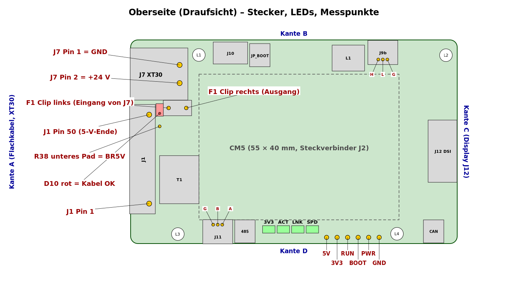
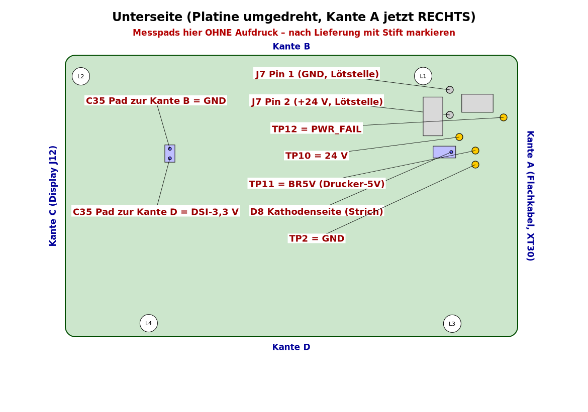

# Aufbau und Inbetriebnahme K2-CM5-Träger Alpha 1

Stand 24.10.2026. Hardware-Inbetriebnahme der bei JLCPCB bestückten Platine in Etappen, vom Auspacken bis zum Einbau in
den Creality K2 Plus. Die Software-Schritte (Paket einspielen, Klipper umstellen, Prüfbefehle) stehen **nicht** hier,
sondern in [`pi-host/traeger-alpha1/README-traeger-alpha1.md`](../../pi-host/traeger-alpha1/README-traeger-alpha1.md)
(im Folgenden **Software-README**). An den passenden
Stellen steht, welcher Schritt dort an der Reihe ist.

> **ALPHA – NUR FÜR TESTZWECKE – NICHT FÜR DEN KOMMERZIELLEN EINSATZ – NUTZUNG AUF EIGENE GEFAHR.** Lizenz und
> Haftungsausschluss: [`../LIZENZ-UND-HAFTUNG.md`](../LIZENZ-UND-HAFTUNG.md). Bekannte Kompromisse und Risiken:
> [`KOMPROMISSE-UND-OFFENE-PUNKTE.md`](KOMPROMISSE-UND-OFFENE-PUNKTE.md).

## 0. Überblick

| Etappe | Wo | Strom | Inhalt |
|---|---|---|---|
| 1 | Tisch | kein Strom | Sichtprüfung, J7 löten (falls nicht von JLC), Messpads markieren, Jumper stecken |
| 2 | Tisch | kein Strom | Widerstand, Durchgang und Diodentest – kein Kurzschluss, D8 richtig herum |
| 3 | Tisch, dann Drucker | Drucker AUS, dann kurz AN | 24-V-Kabel (XT30) bauen und prüfen |
| 4 | Tisch | 24 V, **ohne CM5** | erster Spannungstest: 24 V, 5,2 V, keine 3,3 V ohne CM5 |
| 5 | Tisch | USB vom PC, ohne CM5 | (optional) Notversorgung über J10 und Vorrang der 24 V |
| 6 | am IO-Board | Drucker und Pi wie im heutigen Betrieb | Software vorbereiten → **Software-README Teil A, Schritte 1–9** |
| 7 | Drucker | Drucker AN, **ohne CM5** | Probelauf: Flachkabel J1 richtig herum (D10), Drucker-5V |
| 8 | Tisch | kein Strom | CM5 mit Kühlkörper montieren |
| 9 | Tisch | 24 V, mit CM5 | erster Start, Spannungen mit CM5, Display und Touch, optional Flashen über J10 |
| 10 | Drucker | Drucker AUS | Einbau, alle Kabel stecken → **Software-README Schritte 14–15** |
| 11 | Drucker | Drucker AN | Messungen im eingebauten Zustand → **Software-README Schritt 16** |
| 12 | Drucker | Drucker AN → AUS | Haltezeit nach Stromausfall (Oszilloskop oder Log) → **Software-README Schritt 17** |

Die Etappen bauen aufeinander auf. **Nie eine Etappe überspringen**, auch wenn sie „langweilig“ aussieht: Jede Etappe
schützt das teure Teil der nächsten (Etappe 2 schützt das Netzteil, Etappe 4 den CM5, Etappe 7 den CM5 vor einem
verdrehten Flachkabel).

### 0.1 Werkzeug und Material

| Werkzeug / Material | Wofür |
|---|---|
| Multimeter mit Diodentest und Durchgangsprüfer (Piepser), Messspitzen **spitz** (Nadelspitzen) | alle Messungen |
| Mini-Greifer (IC-Klemmprüfspitze) für die schwarze Leitung | Masse an JP_BOOT festklemmen |
| Lupe ≥ 5-fach oder Handykamera mit Makro, gute Lampe | Sichtprüfung |
| Labornetzteil 0–30 V mit einstellbarer Strombegrenzung (empfohlen) | Etappen 4 und 9 |
| Lötkolben (≥ 60 W, Spitze 2–3 mm), Lötzinn, Flussmittel, Seitenschneider | J7, XT30-Kabel |
| Platinenhalter („dritte Hand“ mit Kunststoffbacken) **oder** zwei Stücke dünne Litze (≈ 0,14 mm², 10 cm) | Messen an den Pads der Unterseite bei laufendem Träger |
| isolierende Unterlage (Karton, Silikonmatte) | Träger liegt beim Test nie auf Metall |
| wasserfester Feinliner (Folienstift) | Messpads der Unterseite beschriften |
| Oszilloskop (optional, 2 Kanäle) | Etappe 12 |
| PC mit `rpiboot` (Raspberry-Pi-usbboot) und USB-A-auf-USB-C-Kabel (optional) | Etappe 5 und 9b |

Bezugsquellen und Spezifikationen: `EINKAUFSLISTE.md`.

### 0.2 Grundregeln Multimeter (jedes Mal)

1. Schwarze Messleitung steckt in der Buchse **COM**, rote in der Buchse **VΩ**. Nie in der Buchse **A/mA** – dort
   wäre jede Spannungsmessung ein Kurzschluss.
2. Den Drehschalter **vor** dem Aufsetzen der Spitzen auf die Messart stellen, die über der Tabelle steht.
3. Widerstand, Durchgang und Diodentest **nur stromlos**.
4. Spitzen senkrecht aufsetzen, nicht abrutschen. Nie mit einer Spitze zwei Pads gleichzeitig berühren. Die Messpads
   5V, 3V3, RUN, BOOT, PWR, GND liegen nur 2,9 mm auseinander: **5 V auf 3V3 kurzzuschließen kann den CM5 zerstören**,
   PWR oder RUN gegen GND schaltet ihn hart aus.
5. Ergebnis mit Vorzeichen und Einheit notieren (z. B. „5,19 V“, „OL“, „0,3 Ω“).
6. **Sofort Strom aus** heißt in dieser Anleitung immer: Labornetzteil-Ausgang AUS bzw. Drucker am Hauptschalter AUS –
   je nachdem, was gerade versorgt. Erst danach überlegen.

### 0.3 Bezeichnungen auf der Platine

- **Kanten:** A = links (Flachkabel J1, 24-V-Stecker J7), B = oben (USB-C J10, JP_BOOT, Spule L1, CAN J9b),
  C = rechts (Display J12), D = unten (RS485 J11, LEDs, Messpads, Jumper). „Links/rechts/oben/unten“ gilt immer für die
  **Draufsicht von oben** (Bauteilseite mit dem CM5 nach oben, Kante A links), wenn nichts anderes dasteht.
- **Messpads Oberseite** (Reihe an Kante D, mit Aufdruck): TP3 „5V“, TP4 „3V3“, TP5 „RUN“, TP6 „BOOT“, TP7 „PWR“,
  TP1 „GND“ (von links nach rechts).
- **Messpads Unterseite – ohne Aufdruck!** TP10 = 24 V, TP11 = BR5V (Drucker-5V vom Flachkabel), TP12 = PWR_FAIL,
  TP2 = GND. Sie liegen unter J7/F1 nahe Kante A. Die Bauteilnamen stehen nur in den Fertigungsdaten, nicht auf der
  Platine. Lage: Skizze unten. In Etappe 1 werden sie mit Stift beschriftet.
- **Masse zum Festklemmen:** Es gibt keinen Massestift außer dem **rechten Stift von JP_BOOT** (Pin 2 = GND, Kante B:
  der rechte der beiden Stifte über dem Aufdruck „RPIBOOT“). Der linke Stift ist nRPIBOOT – den Mini-Greifer nur an den rechten Stift.
- **24 V von oben messbar:** am **rechten Clip von F1** (Ausgang der Sicherung, = 24 V vor dem 5-mΩ-Shunt). Der linke
  Clip ist der Eingang von J7.
- **Drucker-5V von oben messbar:** am **unteren Pad von R38** (direkt unter der roten LED D10).

### 0.4 Warum die Reihenfolge so ist

Der Träger hat drei Spannungsquellen: die 24 V vom Netzteil (J7), die 5 V des Druckers über das Flachkabel (J1, nur für
die LED D10 und die RS485-Ruhevorspannung) und optional 5 V über die Notfall-USB-C-Buchse J10. Der CM5 erzeugt seine
3,3 V selbst; alle 3,3-V-Teile des Trägers hängen daran. **Ohne CM5 gibt es deshalb keine 3,3 V** – das ist in Etappe 4
eine wichtige Kontrolle: Wer ohne CM5 an „3V3“ eine Spannung misst, hat einen Fehler gefunden, bevor der CM5 ihn
abbekommt.

## Etappe 1 – Sichtprüfung (Tisch, kein Strom)

**Ist-Zustand:** Die Platine kommt aus der JLC-Verpackung. Kein Kabel, kein CM5, keine Jumper-Kappen (JLC lötet nur die
Stiftleisten, steckt aber keine Kappen auf). Kein Strom.

1. Platine an den Kanten anfassen, nicht an den Steckverbindern. Vorher an einem geerdeten Metallteil (Heizkörper)
   entladen.
2. Mit Lupe und Lampe die Punkte der folgenden Tabelle prüfen. Fotos von beiden Seiten machen (für spätere Vergleiche).

| Was | Worauf achten | Wenn nicht in Ordnung |
|---|---|---|
| J2 (zwei Hirose DF40, 2 × 100 Kontakte, Raster 0,4 mm, unter dem späteren CM5) | alle Kontakte sauber verlötet, **keine Zinnbrücken** zwischen Nachbarkontakten, Steckverbinder liegen plan | Brücke: nicht selbst nachlöten, Fotos an JLC (Reklamation) – der CM5 käme sonst an falsche Spannungen |
| J1 (Flachkabelbuchse 50-pol., Kante A) | dunkler Klappbügel vorhanden und beweglich, Öffnung zeigt nach **links** (Kante A), keine Brücken | Bügel fehlt/gebrochen: Reklamation |
| J12 (Displaybuchse 22-pol., Kante C) | Klappbügel vorhanden und beweglich, Öffnung zeigt nach **rechts** (Kante C), keine Brücken | Bügel fehlt/gebrochen oder Brücke: Reklamation |
| J9b (Kante B) und J11 (Kante D) | stehende JST-GH-Stecker, gerade, alle 3 Lötfahnen und beide Haltelaschen verlötet | Haltelasche lose: nachlöten (einfach) |
| J10 (USB-C stehend, Kante B) | senkrecht, Schirmlaschen verlötet | Reklamation |
| F1 (Sicherungshalter, zwischen J7 und J1) | **Sicherung steckt im Halter** (kleiner Körper mit Aufdruck, z. B. „3“ oder „F 3A“) | fehlt: Ersatzsicherung 0453003.MR oder 0452003.MRL einsetzen |
| T1 (Übertrager, links unten auf der Oberseite) | Pin-1-Punkt auf dem Gehäuse **unten rechts** (zur Kante D und zum CM5 hin) | um 180° verdreht: Ethernet geht nicht, sonst kein Schaden – melden |
| D8 (TVS-Diode, Unterseite unter F1) | Kathodenstrich auf der Seite **zur Kante A** (in der Ansicht von unten rechts) | Strich auf der anderen Seite: **nicht einschalten** – 24 V würden über D8 kurzgeschlossen; Etappe 2 bestätigt das |
| ICs der Unterseite (U1–U14) | Pin-1-Punkt am Gehäuse passt zum Punkt/Dreieck im Aufdruck | abweichend: Foto, nicht einschalten, melden |
| Lötbrücken JP2, JP3, JP5, JP6, JP7 (Unterseite) | Kupferbrücke zwischen den beiden Halbmonden sichtbar (ab Werk geschlossen) | offen: melden (JP5 offen = keine USB-Notversorgung, sonst harmlos) |
| R43, R44 (Unterseite, neben JP6/JP7) | **leer** (Bestückoption, absichtlich nicht bestückt) | bestückt: melden |
| ganze Platine | keine Lotkugeln, keine Späne, nicht verbogen | Lotkugeln mit Pinsel entfernen |

3. **J7 löten (nur falls nicht bei JLC mitbestückt):** XT30PW-M von **oben** einsetzen, Stecköffnung zeigt nach
   **links über die Kante A** hinaus. Die beiden Lötstifte gehen durch die zwei großen Pads rechts neben dem
   Steckergehäuse. Gehäuse plan auf die Platine drücken (mit Klebeband fixieren), auf der Unterseite beide Stifte löten
   (Lötkolben ≈ 350–380 °C, reichlich Flussmittel, je Stift 3–4 s). Danach die Stifte unten mit dem Seitenschneider auf
   **≤ 0,4 mm** kürzen – unter der Platine sind nur 2,45 mm Luft.
4. **Messpads der Unterseite beschriften:** Platine umdrehen (Kante A liegt jetzt rechts). Nach der Skizze „Unterseite“
   die vier runden Pads unter J7/F1 suchen und daneben mit Folienstift schreiben: „24V“ (TP10), „5D“ für Drucker-5V
   (TP11), „PF“ für PWR_FAIL (TP12), „G“ (TP2). Kontrolle der Zuordnung in Etappe 2 (Messungen M2.2, M2.5, M2.5a und M2.15a).
5. **Jumper-Kappen stecken:**

| Jumper (Siebdruck) | Lage | Kappe | Bedeutung |
|---|---|---|---|
| JP_CAN_TERM („CAN 120R“) | Kante D rechts | **stecken** | CAN-Abschluss 120 Ω (Träger ist Busende) |
| JP_485_TERM („485 120R“) | Kante D links neben J11 | **nicht** stecken | RS485 ist am Mainboard abgeschlossen |
| JP_BOOT („RPIBOOT“) | Kante B neben J10 | **nicht** stecken | gesteckt = CM5 startet nicht vom eMMC, sondern wartet auf USB (Etappe 9b) |

## Etappe 2 – Stromlose Messungen (Tisch, kein Strom)

**Ist-Zustand:** wie nach Etappe 1. Kein Kabel gesteckt (J1, J7, J9b, J10, J11, J12 frei), **kein CM5**, kein Strom.
Jumper-Kappe nur auf JP_CAN_TERM.

**Warum:** Ein Kurzschluss zwischen 24 V und Masse würde beim ersten Einschalten die Sicherung F1 auslösen, im
schlimmsten Fall Leiterbahnen verbrennen. Ein Kurzschluss zwischen 24 V und den 5-V- oder 3,3-V-Netzen würde später den
CM5 zerstören. Beides lässt sich stromlos sicher finden. Kondensatoren laden sich bei der Widerstandsmessung durch den
Messstrom auf – der Wert **steigt** dann langsam an. Das ist richtig und kein Fehler; abgelesen wird nach ≈ 5 s.

### 2.1 Durchgang (Masse und Eingangsweg)

Messart: **Durchgang (Piepser)**. Selbsttest zuerst: beide Spitzen aneinander → muss piepen.

| Messung | **rote** Spitze an | **schwarze** Spitze an | erwartet |
|---|---|---|---|
| M2.1 Masse oben ↔ JP_BOOT | Messpad TP1 „GND“ (Oberseite, Kante D, rechtes Pad der Reihe) | JP_BOOT rechter Stift (Pin 2) | piept, < 1 Ω |
| M2.2 Masse oben ↔ unten | Messpad TP1 „GND“ | Unterseite TP2 (Pad „G“) | piept, < 1 Ω |
| M2.3 Masse J7 | J7 Pin 1 (oberes großes Pad rechts neben dem XT30-Gehäuse, Aufdruck „GND“) | Messpad TP1 „GND“ | piept, < 1 Ω |
| M2.4 Eingang J7 → F1 | J7 Pin 2 (unteres großes Pad, Aufdruck „+24V“) | F1 linker Clip | piept, < 1 Ω |
| M2.5 Sicherung F1 + Shunt R23 | F1 linker Clip | Unterseite TP10 (Pad „24V“) | piept, < 1 Ω |
| M2.5a Pad „5D“ = Drucker-5V | Unterseite TP11 (Pad „5D“) | Oberseite R38, unteres Pad (unter D10) | piept, < 1 Ω |

**Wenn der Wert nicht stimmt:**

| Messung | Abweichung | mögliche Ursache | nächste Prüfung |
|---|---|---|---|
| M2.1–M2.3 | kein Piepen | Messpad verwechselt oder Lötfehler an J7 Pin 1 | Skizze vergleichen; J7-Lötstellen unten ansehen |
| M2.5a | kein Piepen | Pads „5D“ und „24V“ verwechselt beschriftet | mit der Skizze vergleichen, Beschriftung korrigieren |
| M2.4 | kein Piepen | J7 Pin 2 nicht verlötet | Lötstelle nachlöten, neu messen |
| M2.5 | kein Piepen | Sicherung fehlt/defekt, oder TP10 verwechselt | Sicherung herausnehmen und einzeln messen (muss piepen); Pad-Zuordnung prüfen |

### 2.2 Widerstand (kein Kurzschluss)

Messart: **Widerstand (Ω)**, Bereich automatisch oder 200 kΩ. Ablesen nach ≈ 5 s.

| Messung | **rote** Spitze an | **schwarze** Spitze an | erwartet |
|---|---|---|---|
| M2.6 24 V gegen Masse | J7 Pin 2 („+24V“) | J7 Pin 1 („GND“) | > 10 kΩ, steigend |
| M2.7 5-V-Schiene gegen Masse | Messpad TP3 „5V“ | Messpad TP1 „GND“ | > 1 kΩ, steigend |
| M2.8 3,3-V-Schiene gegen Masse | Messpad TP4 „3V3“ | Messpad TP1 „GND“ | > 500 Ω (Wert kann schwanken: LED D11 und ICs hängen daran) |
| M2.9 24 V gegen 5 V | J7 Pin 2 („+24V“) | Messpad TP3 „5V“ | > 10 kΩ |
| M2.10 24 V gegen 3,3 V | J7 Pin 2 („+24V“) | Messpad TP4 „3V3“ | > 10 kΩ |
| M2.11 5 V gegen 3,3 V | Messpad TP3 „5V“ | Messpad TP4 „3V3“ | > 500 Ω |
| M2.12 Drucker-5V gegen Masse | Unterseite TP11 (Pad „5D“) | Messpad TP1 „GND“ | > 1 kΩ |
| M2.13 Display-3,3 V gegen Masse | Unterseite C35, Pad zur Kante D | Messpad TP1 „GND“ | > 1 kΩ, steigend |
| M2.14 CAN-Abschluss | J9b, linke Lötfahne „H“ (vor dem Gehäuse, zur Platinenmitte hin) | J9b, mittlere Lötfahne „L“ | 115–125 Ω (Kappe auf JP_CAN_TERM) |
| M2.15 RS485 ohne Abschluss | J11, rechte Lötfahne „A“ | J11, mittlere Lötfahne „B“ | > 1 kΩ (kein 120 Ω, Kappe JP_485_TERM **nicht** gesteckt) |
| M2.15a Pad „PF“ = PWR_FAIL | Unterseite TP12 (Pad „PF“) | Messpad TP4 „3V3“ | 9,5 … 10,5 kΩ (Pull-up R50) |

Zur Kontrolle von M2.14: Kappe von JP_CAN_TERM kurz abziehen → > 10 kΩ; Kappe wieder stecken.

**Wenn der Wert nicht stimmt:**

| Messung | Abweichung | mögliche Ursache | nächste Prüfung |
|---|---|---|---|
| M2.6 | < 100 Ω | Kurzschluss im 24-V-Weg: D8 verdreht/defekt, Lotbrücke an C9/C10/U7 | M2.16 (Diodentest D8); Unterseite um D8, C9, C10, U7 mit Lupe absuchen. **Nicht einschalten.** |
| M2.7 | < 100 Ω | Brücke an C14–C22, U8, R24 oder am CM5-Steckverbinder J2 | Lupe auf J2 (5-V-Pins), Unterseite um U8/R24. Nicht einschalten. |
| M2.8 | < 50 Ω | Brücke an einem 3,3-V-IC (U1–U5, U10–U13) oder an J2 | Lupe; nicht einschalten |
| M2.9, M2.10 | < 10 kΩ | 24 V berührt ein 5-V- oder 3,3-V-Netz (Lotbrücke, Fertigungsfehler Innenlage) | **Platine nicht weiter verwenden**, Fotos und Werte an JLC/melden – das wäre der Weg, auf dem 24 V den CM5 erreichen |
| M2.11 | < 500 Ω | 5-V- und 3,3-V-Netz verbunden | **Platine nicht weiter verwenden**, nie einen CM5 einsetzen; Fotos und Werte melden |
| M2.12 | < 100 Ω | Brücke an R38/D10/R15 oder an J1 | Lupe an J1 (Pins 45–50 oben) |
| M2.13 | < 100 Ω | Brücke an U14/L2/C35/C36 | Lupe Unterseite rechts oben |
| M2.14 | > 10 kΩ mit Kappe | Kappe sitzt nicht, R19 fehlt | Kappe neu stecken |
| M2.14 | ≈ 60 Ω | zweiter Abschluss irgendwo (Fertigungsfehler) | melden |
| M2.15 | ≈ 120 Ω | Kappe doch auf JP_485_TERM | Kappe abziehen |
| M2.15a | „OL“ oder ≪ 10 kΩ | Pad verwechselt beschriftet bzw. R50 fehlt | Skizze vergleichen; R50 (Unterseite, neben TP12) mit Lupe prüfen |

### 2.3 Diodentest – liegt D8 richtig herum?

Messart: **Diodentest** (Diodensymbol). Diese Messung ist die wichtigste der Etappe: Die TVS-Diode D8 liegt direkt
zwischen 24 V und Masse. Richtig eingebaut sperrt sie bei +24 V (und leitet nur bei Verpolung). Falsch herum eingebaut
würde sie die 24 V kurzschließen.

| Messung | **rote** Spitze an | **schwarze** Spitze an | erwartet |
|---|---|---|---|
| M2.16 Sperrrichtung | J7 Pin 2 („+24V“) | J7 Pin 1 („GND“) | „OL“ oder > 1,5 V (Anzeige steigt, weil C9/C10 laden) |
| M2.17 Durchlassrichtung | J7 Pin 1 („GND“) | J7 Pin 2 („+24V“) | 0,4–0,8 V |

**Wenn der Wert nicht stimmt:**

| Messung | Abweichung | mögliche Ursache | nächste Prüfung |
|---|---|---|---|
| M2.16 | 0,4–0,8 V | D8 um 180° verdreht bestückt | **Nicht einschalten.** D8 auslöten und gedreht einlöten (Kathodenstrich zur Kante A) oder Reklamation |
| M2.17 | „OL“ | D8 fehlt oder keine Masseverbindung | M2.3 wiederholen; D8 mit Lupe prüfen. Ohne D8 fehlt nur der Überspannungs-/Verpolschutz |

**Ende Etappe 2:** Alle Werte notiert, keine Abweichung. Sonst nicht weiter.

## Etappe 3 – 24-V-Kabel bauen und prüfen

Das Kabel verbindet eine **freie Klemme +V/−V** des Drucker-Netzteils (Creality CHP-350-24) mit J7. Bauteile und
Querschnitt: `EINKAUFSLISTE.md` (Abschnitt „24-V-Kabel“). Die Länge hängt vom Weg im Drucker ab – **vorher messen**
(Netzteil bis Display-Einheit, Kabel in Bögen führen, +20 cm Reserve).

### 3.1 Kabel bauen (Tisch, kein Strom)

1. XT30-Kabelbuchse (Gegenstück zu J7) mit zwei Adern, **rot** und **schwarz**, 0,75 mm² (AWG 18).
2. Wenn die Buchse selbst gelötet wird: Buchse **vor dem Löten** probeweise in J7 stecken (Platine liegt stromlos auf
   dem Tisch). Mit dem Durchgangsprüfer feststellen, welcher Lötkelch der Buchse mit dem **linken Clip von F1** piept –
   an diesen Kelch kommt die **rote** Ader. Der andere Kelch piept mit TP1 „GND“ – dort die **schwarze** Ader. Buchse
   abziehen, löten, Schrumpfschlauch.
3. Am anderen Ende je einen **isolierten Gabelkabelschuh** aufcrimpen (rot an rot, schwarz an schwarz). Die
   Schraubengröße der Netzteilklemmen ist nicht dokumentiert: **an der Klemme messen** (Schraubendurchmesser,
   Klemmenbreite), dann den passenden Kabelschuh wählen.

### 3.2 Zuordnung Ader ↔ J7 prüfen (Tisch, kein Strom)

**Ist-Zustand:** Kabel fertig, XT30-Buchse in **J7** gesteckt, Gabelkabelschuhe frei in der Luft (nirgends
angeschlossen). Kein CM5, kein anderes Kabel am Träger. Kein Strom.

| Verbindung | Ende 1 | Ende 2 |
|---|---|---|
| 24-V-Kabel | XT30-Buchse in J7 (Träger) | Gabelkabelschuhe frei |

Messart: **Durchgang (Piepser)**.

| Messung | **rote** Spitze an | **schwarze** Spitze an | erwartet |
|---|---|---|---|
| M3.1 rote Ader = +24 V | Gabelkabelschuh der **roten** Ader | F1 linker Clip | piept |
| M3.2 schwarze Ader = GND | Gabelkabelschuh der **schwarzen** Ader | Messpad TP1 „GND“ | piept |
| M3.3 keine Vertauschung | Gabelkabelschuh der **roten** Ader | Messpad TP1 „GND“ | kein Piepen |

**Wenn der Wert nicht stimmt:** M3.1 piept nicht, aber M3.3 piept → Adern in der XT30-Buchse vertauscht (bei einem
fertig gekauften Kabel: die Farbbelegung des Kabels passt nicht zur Belegung von J7 – Pin 2 = +24 V). **Dieses Kabel
nicht verwenden**; selbst gelötet: umlöten; gekauft: Befund notieren und melden (offener Punkt „XT30-Polarität“ in
`KOMPROMISSE-UND-OFFENE-PUNKTE.md`), Kabel neu bauen. Danach Kabel aus J7 ziehen.

### 3.3 Kabel am Netzteil anschließen und Polarität mit Spannung prüfen (Drucker)

**Gefahr:** Am Netzteil liegen **230 V** (Klemmen L, N, Schutzleiter) direkt neben den 24-V-Klemmen. Nur mit
gezogenem Netzstecker arbeiten.

**Ist-Zustand:** Drucker wie heute (CM5 auf dem IO-Board, Breakout am Flachkabel). Das 24-V-Kabel ist **nicht** am
Träger gesteckt. Der Träger liegt auf dem Tisch.

Ausschalten (vollständige Reihenfolge):

1. In Mainsail prüfen: kein Druck läuft.
2. Pi herunterfahren (`sudo poweroff` oder Mainsail → Herunterfahren), warten, bis die ACT-LED des IO-Boards 10 s aus ist.
3. Pi-Netzteil (USB-C am IO-Board) aus der Steckdose ziehen.
4. Drucker am Hauptschalter AUS.
5. **Netzstecker des Druckers ziehen.**
6. 2 Minuten warten (Kondensatoren im Netzteil entladen sich).

Anschließen:

7. Netzteil-Abdeckung öffnen, freie Klemmen **+V** und **−V** suchen (Aufdruck am Klemmenblock). Nie L, N oder PE (Schutzleiter).
8. Schraube der freien +V-Klemme lösen, **roten** Gabelkabelschuh darunter, festziehen. Ebenso **schwarz** an eine freie
   −V-Klemme. Zugprobe an jeder Ader.
9. Kabel zur Display-Einheit verlegen, fern von bewegten Teilen, mit Kabelbindern sichern. Das XT30-Ende hängt frei,
   Kontakte zeigen nach unten, **nichts berührt Metall**. Netzteil-Abdeckung schließen.

| Verbindung | Ende 1 | Ende 2 |
|---|---|---|
| 24-V-Kabel rot | Netzteil Klemme +V | XT30-Buchse (frei, nicht gesteckt) |
| 24-V-Kabel schwarz | Netzteil Klemme −V | XT30-Buchse (frei, nicht gesteckt) |

Einschalten:

10. Netzstecker des Druckers einstecken.
11. Drucker am Hauptschalter AN. (Das Pi-Netzteil bleibt gezogen – der Pi wird hierfür nicht gebraucht.)

Messart: **Gleichspannung V⎓, Bereich 200 V** (oder Auto). Die Kontakte der XT30-Buchse liegen versenkt: Nadelspitzen
verwenden, nicht verkanten, die beiden Kontakte nie gleichzeitig berühren.

| Messung | **rote** Spitze an | **schwarze** Spitze an | erwartet |
|---|---|---|---|
| M3.4 Polarität am Stecker | Kontakt der XT30-Buchse, an dem die **rote** Ader angelötet ist | Kontakt der **schwarzen** Ader | **+23,5 … +24,5 V** |

Ausschalten:

12. Drucker am Hauptschalter AUS.
13. 1 Minute warten. Die XT30-Buchse bleibt frei hängen (für Etappe 4.2/7). Sie führt ab jetzt **bei jedem laufenden
    Drucker 24 V**: Die Kontakte liegen zwar versenkt, trotzdem eine Kappe oder Klebeband darüber und so ablegen, dass
    sie nichts berührt.
14. Soll der Drucker bis Etappe 6 normal weiterlaufen: Drucker am Hauptschalter AN, 30 s warten, Pi-Netzteil (USB-C am
    IO-Board) einstecken, 90 s warten.

**Wenn der Wert nicht stimmt:**

| Abweichung | mögliche Ursache | nächste Prüfung |
|---|---|---|
| −24 V (negatives Vorzeichen) | Gabelkabelschuhe an +V/−V vertauscht | Drucker am Hauptschalter AUS, Netzstecker ziehen, 2 min warten; rot und schwarz an der Klemme tauschen; Netzstecker einstecken, Hauptschalter AN, M3.4 wiederholen. **Nie** ein Kabel mit −24 V in J7 stecken: D8 leitet, F1 löst aus |
| 0 V | Klemme nicht angezogen, Kabelschuh auf Isolierung gecrimpt, Netzteil-Ausgang abgeschaltet | Drucker am Hauptschalter AUS, Netzstecker ziehen, 2 min warten; Klemmen und Crimpung prüfen |
| < 23 V oder > 25 V | Netzteil-Ausgang verstellt oder überlastet | Spannung direkt an den Klemmen messen; Wert notieren, melden |

## Etappe 4 – Erster Spannungstest ohne CM5 (Tisch)

**Warum ohne CM5:** Wenn der Wandler falsch regelt (z. B. 24 V statt 5,2 V am Ausgang) oder ein Netz verbunden ist, das
getrennt sein müsste, merkt man das hier, ohne dass der CM5 (≈ 100 €) daran hängt.

**Ist-Zustand:** Träger nach Etappe 2, ohne CM5, auf isolierender Unterlage. Kein Kabel gesteckt.

### 4.1 Variante A (empfohlen): Labornetzteil mit Strombegrenzung

Das Labornetzteil begrenzt den Strom. Bei einem Kurzschluss bricht nur seine Spannung ein, nichts brennt. Die
Druckernetzteil-Variante 4.2 hat diese Sicherheit nicht (nur F1 mit 3 A).

Vorbereitung (Ausgang AUS):

1. Labornetzteil einschalten, **Ausgang AUS**. Spannung **24,0 V**, Strombegrenzung **0,10 A** einstellen.
2. Labornetzteil-Ausgang wieder AUS, falls er beim Einstellen an war.
3. Für das Labornetzteil ein **zweites** XT30-Kabel bauen (XT30-Buchse, rote und schwarze Ader, am anderen Ende
   Bananenstecker oder Gabelkabelschuhe für die Polklemmen). Stromlos prüfen, Messart **Durchgang (Piepser)**:
   Buchse in J7 stecken; rote Ader ↔ F1 linker Clip muss piepen, schwarze Ader ↔ Messpad TP1 „GND“ muss piepen,
   rote Ader ↔ TP1 darf **nicht** piepen. Stimmt eine davon nicht: Adern in der Buchse vertauscht – umlöten.
4. Verbindung herstellen:

| Verbindung | Ende 1 | Ende 2 |
|---|---|---|
| +24 V | Labornetzteil Buchse „+“ (rot) | Träger J7 Pin 2 (über XT30-Kabel, rote Ader) |
| Masse | Labornetzteil Buchse „−“ (schwarz) | Träger J7 Pin 1 (über XT30-Kabel, schwarze Ader) |
| Messmasse | Multimeter COM (schwarze Leitung mit Mini-Greifer) | JP_BOOT rechter Stift (GND) |

Einschalten:

5. Auf die Platine schauen, Hand am Ausgangsschalter.
6. Labornetzteil-Ausgang **AN**.
7. Sofort die Stromanzeige lesen: erwartet **unter 50 mA** (Schätzung: Wandler im Leerlauf ohne Last; kein CM5,
   keine LED leuchtet). Zeigt das Netzteil **„CC“** (Strombegrenzung aktiv) oder fällt die Spannung unter 23 V:
   **sofort Ausgang AUS** → Kurzschluss, siehe Tabelle unten.

Messart: **Gleichspannung V⎓, Bereich 20 V** (bzw. 200 V für M4.1, wenn das Gerät nicht automatisch umschaltet).
Schwarze Leitung bleibt am Mini-Greifer (JP_BOOT rechter Stift).

| Messung | **rote** Spitze an | **schwarze** Spitze an | erwartet |
|---|---|---|---|
| M4.1 24 V nach der Sicherung | F1 rechter Clip | JP_BOOT rechter Stift (GND) | 23,8 … 24,0 V (Netzteilwert minus wenige mV) |
| M4.2 Wandler 5,2 V | Messpad TP3 „5V“ | JP_BOOT rechter Stift (GND) | **5,10 … 5,30 V** (Soll 5,20 V) |
| M4.3 keine 3,3 V ohne CM5 | Messpad TP4 „3V3“ | JP_BOOT rechter Stift (GND) | **< 0,10 V** |
| M4.4 keine Drucker-5V ohne Flachkabel | R38 unteres Pad (unter D10) | JP_BOOT rechter Stift (GND) | < 0,10 V |
| M4.5 Stromausfall-Leitung | Unterseite TP12 (Pad „PF“) | JP_BOOT rechter Stift (GND) | < 0,10 V (der Pull-up hängt an den 3,3 V des CM5) |
| M4.6 Display-3,3 V aus | Unterseite C35, Pad zur Kante D | JP_BOOT rechter Stift (GND) | < 0,10 V (Display-Wandler ist nur mit laufendem CM5 an) |
| M4.7 24 V nach dem Shunt | Unterseite TP10 (Pad „24V“) | JP_BOOT rechter Stift (GND) | 23,8 … 24,0 V (höchstens 0,01 V unter dem Wert von M4.1) |

Für M4.5–M4.7 die Platine im Platinenhalter senkrecht stellen (Unterseite erreichbar) **oder** vorher stromlos je eine
dünne Litze an TP12 und TP10 anlöten, nach oben führen, beschriften und nach Etappe 9 wieder ablöten (unter der Platine
sind nur 2,45 mm Luft – keine Drahtreste lassen). Die Messpads RUN, BOOT und PWR werden ohne CM5 **nicht** ausgewertet
(sie hängen offen und zeigen Zufallswerte). Alle LEDs sind aus.

Ausschalten:

8. Labornetzteil-Ausgang AUS.
9. 10 s warten, dann erst Kabel oder Messspitzen umsetzen.

**Wenn der Wert nicht stimmt:**

| Messung | Abweichung | sofort | mögliche Ursache | nächste Prüfung |
|---|---|---|---|---|
| Strom | „CC“, Spannung bricht ein | Ausgang AUS | Kurzschluss, den Etappe 2 nicht gefunden hat (z. B. erst unter Spannung leitende TVS) | Etappe 2 wiederholen; Platine im Dunkeln mit Wärmebild/Fingerprobe (Ausgang kurz an, 0,1 A) – das warme Bauteil ist der Kurzschluss |
| M4.1 | 0 V | Ausgang AUS | F1-Sicherung offen, J7 nicht verlötet | M2.4/M2.5 wiederholen |
| M4.2 | 0 V | Ausgang AUS | Wandler U7 startet nicht (Lötfehler WSON-12) oder Power-Mux U8 schaltet nicht durch | Lupe auf U7/U8; melden |
| M4.2 | > 5,4 V | **sofort Ausgang AUS** | Regelung defekt (R26/R27 vertauscht oder fehlend), **nie CM5 einsetzen** | Werte R26 (105 kΩ) und R27 (19,1 kΩ) stromlos messen; melden |
| M4.2 | 4,9 … 5,1 V | Ausgang AUS | Toleranz/Teiler leicht daneben | noch zulässig (CM5: 4,75–5,25 V), notieren |
| M4.3, M4.6 | > 0,3 V | Ausgang AUS | Rückspeisung: 5 V gelangt in das 3,3-V-Netz (Brücke, falsches Bauteil) | **Kein CM5 einsetzen**; M2.11 wiederholen; melden |
| M4.4 | > 0,3 V | Ausgang AUS | 24 V oder 5 V erreicht das Drucker-5V-Netz | melden – das Flachkabel würde Spannung zum Bridge-Board schicken |
| M4.7 | > 0,1 V weniger als M4.1 | Ausgang AUS | Shunt R23 schlecht verlötet | Lupe auf R23 |

### 4.2 Variante B: Druckernetzteil (nur, wenn kein Labornetzteil da ist)

Versorgung über das 24-V-Kabel aus Etappe 3. Einziger Schutz ist F1 (3 A, flink) – es gibt keine Strombegrenzung, ein
Kurzschluss zeigt sich erst durch das Auslösen von F1 oder durch Wärme. Diese Variante nur, wenn **alle** Werte der
Etappe 2 stimmen.

**Ist-Zustand:** 24-V-Kabel am Netzteil angeschlossen (Etappe 3.3), XT30-Buchse hängt frei. Drucker am Hauptschalter
AUS, Pi-Netzteil gezogen. Träger ohne CM5 liegt **neben** dem Drucker auf isolierender Unterlage (reicht das Kabel nicht
so weit: im Drucker auf Karton, nichts berührt Metall). Kein anderes Kabel am Träger.

1. Läuft der Drucker noch (Etappe 3.3, Schritt 14): in Mainsail prüfen, dass kein Druck läuft; Pi herunterfahren
   (`sudo poweroff`), warten, bis die ACT-LED des IO-Boards 10 s aus ist; Pi-Netzteil ziehen; Drucker am Hauptschalter
   AUS. Sonst prüfen: Drucker am Hauptschalter AUS.
2. Kappe/Klebeband von der XT30-Buchse nehmen, Buchse in **J7** stecken. Mini-Greifer der schwarzen Messleitung an den rechten Stift von JP_BOOT.

| Verbindung | Ende 1 | Ende 2 |
|---|---|---|
| 24 V rot | Netzteil Klemme +V (Gabelkabelschuh) | Träger J7 Pin 2 (XT30) |
| 24 V schwarz | Netzteil Klemme −V (Gabelkabelschuh) | Träger J7 Pin 1 (XT30) |
| Messmasse | Multimeter COM (Mini-Greifer) | JP_BOOT rechter Stift (GND) |

Einschalten:

3. Hand am Hauptschalter, auf die Platine schauen. Drucker am Hauptschalter AN.
4. Riecht es, raucht es, wird ein Bauteil warm (Fingerprobe an U7/L1 nach 10 s nur kurz): **sofort Hauptschalter AUS**.

Messart: **Gleichspannung V⎓, Bereich 20 V** (bzw. 200 V für M4.1B, wenn das Gerät nicht automatisch umschaltet).

| Messung | **rote** Spitze an | **schwarze** Spitze an | erwartet |
|---|---|---|---|
| M4.1B 24 V nach der Sicherung | F1 rechter Clip | JP_BOOT rechter Stift (GND) | 23,5 … 24,5 V |
| M4.2B Wandler 5,2 V | Messpad TP3 „5V“ | JP_BOOT rechter Stift (GND) | **5,10 … 5,30 V** (Soll 5,20 V) |
| M4.3B keine 3,3 V ohne CM5 | Messpad TP4 „3V3“ | JP_BOOT rechter Stift (GND) | **< 0,10 V** |
| M4.4B keine Drucker-5V ohne Flachkabel | R38 unteres Pad (unter D10) | JP_BOOT rechter Stift (GND) | < 0,10 V |
| M4.5B Stromausfall-Leitung | Unterseite TP12 (Pad „PF“) | JP_BOOT rechter Stift (GND) | < 0,10 V |
| M4.6B Display-3,3 V aus | Unterseite C35, Pad zur Kante D | JP_BOOT rechter Stift (GND) | < 0,10 V |
| M4.7B 24 V nach dem Shunt | Unterseite TP10 (Pad „24V“) | JP_BOOT rechter Stift (GND) | höchstens 0,01 V unter M4.1B |

Für M4.5B–M4.7B die Platine im Platinenhalter senkrecht stellen oder die vorher angelöteten Messlitzen an TP12/TP10
verwenden. Alle LEDs sind aus.

Ausschalten:

5. Drucker am Hauptschalter AUS.
6. 1 Minute warten.
7. XT30-Buchse aus J7 ziehen, Mini-Greifer abnehmen.

**Wenn der Wert nicht stimmt:**

| Messung | Abweichung | sofort | mögliche Ursache | nächste Prüfung |
|---|---|---|---|---|
| alle | 0 V überall, F1 ausgelöst (Durchgang über F1 fehlt) | Hauptschalter AUS | Kurzschluss im 24-V-Weg | Etappe 2 wiederholen; Sicherung tauschen erst nach gefundener Ursache |
| M4.1B | 0 V | Hauptschalter AUS | Kabel nicht gesteckt, F1 offen, J7 nicht verlötet | M2.4/M2.5 wiederholen |
| M4.2B | > 5,4 V | **sofort Hauptschalter AUS** | Regelung defekt (R26/R27), **nie CM5 einsetzen** | R26 (105 kΩ) und R27 (19,1 kΩ) stromlos messen; melden |
| M4.2B | 0 V | Hauptschalter AUS | Wandler U7 oder Power-Mux U8 arbeitet nicht | Lupe auf U7/U8; melden |
| M4.3B, M4.6B | > 0,3 V | Hauptschalter AUS | Rückspeisung in das 3,3-V-Netz | **kein CM5**; M2.11 wiederholen; melden |
| M4.4B | > 0,3 V | Hauptschalter AUS | Spannung im Drucker-5V-Netz | melden |
| M4.7B | > 0,1 V unter M4.1B | Hauptschalter AUS | Shunt R23 schlecht verlötet | Lupe auf R23 |

## Etappe 5 (optional) – Notversorgung über J10 und Vorrang der 24 V

**Warum:** Der Power-Mux U8 soll den CM5 aus den 24 V versorgen und nur ersatzweise aus der USB-C-Buchse J10 – nie aus
beiden gleichzeitig (sonst flösse Strom in den PC). Das lässt sich ohne CM5 prüfen.

**Ist-Zustand:** Labornetzteil-Ausgang AUS (24,0 V und 0,10 A eingestellt), XT30-Kabel des Labornetzteils in J7,
Mini-Greifer an JP_BOOT rechts. Kein CM5, kein anderes Kabel.

Hinweis: Ein USB-C-Ladegerät mit USB-C-auf-USB-C-Kabel liefert hier **keine** Spannung – es schaltet erst ein, wenn
das Gerät sich über die CC-Leitungen meldet; das macht der CM5. Ohne CM5 deshalb ein **USB-A-auf-USB-C-Kabel** an einem
PC oder einem einfachen USB-A-Netzteil verwenden (dort liegen die 5 V immer an).

1. Prüfen: Labornetzteil-Ausgang AUS.
2. USB-A-Ende in den PC (oder ein USB-A-Netzteil), USB-C-Ende in **J10**. Damit ist der Träger über USB versorgt.

| Verbindung | Ende 1 | Ende 2 |
|---|---|---|
| USB | PC USB-A-Buchse | Träger J10 |
| 24 V (gesteckt, Ausgang AUS) | Labornetzteil +/− | Träger J7 |
| Messmasse | Multimeter COM (Mini-Greifer) | JP_BOOT rechter Stift |

Messart: **Gleichspannung V⎓, Bereich 20 V**.

| Messung | **rote** Spitze an | **schwarze** Spitze an | erwartet |
|---|---|---|---|
| M5.1 nur USB (Labornetzteil-Ausgang AUS) | Messpad TP3 „5V“ | JP_BOOT rechter Stift (GND) | 4,75 … 5,15 V (USB-Spannung minus Mux) |

3. Labornetzteil-Ausgang **AN** (24,0 V, Begrenzung 0,10 A). Auf die Stromanzeige achten: kein „CC“.

Messart: **Gleichspannung V⎓, Bereich 20 V** (unverändert).

| Messung | **rote** Spitze an | **schwarze** Spitze an | erwartet |
|---|---|---|---|
| M5.2 USB **und** 24 V | Messpad TP3 „5V“ | JP_BOOT rechter Stift (GND) | 5,10 … 5,30 V (der Wandler hat Vorrang) |

Ausschalten:

4. Labornetzteil-Ausgang AUS.
5. USB-C-Kabel aus J10 ziehen.
6. 10 s warten.

**Wenn der Wert nicht stimmt:**

| Messung | Abweichung | sofort | mögliche Ursache | nächste Prüfung |
|---|---|---|---|---|
| M5.1 | 0 V | USB abziehen | Lötbrücke JP5 offen, U8 schaltet nicht auf IN2, Kabel ohne VBUS | anderes Kabel; JP5 (Unterseite) mit Lupe; melden – nur die Notversorgung fehlt, der Normalbetrieb ist nicht betroffen |
| M5.1 | > 5,3 V | USB abziehen | Fremdspannung (USB-Netzteil defekt) | anderes USB-Netzteil |
| M5.2 | bleibt beim USB-Wert (≈ 5,0 V) | Ausgang AUS, USB abziehen | Vorrang über R29/R30 (Teiler an PR1) nicht wirksam | R29 (33 kΩ), R30 (10 kΩ) stromlos messen; melden |
| M5.2 | Labornetzteil zeigt „CC“ | **sofort Ausgang AUS**, USB abziehen | Strom fließt über den Mux zurück (Fehlfunktion U8) | melden, J10 nicht mehr zur Versorgung nutzen |

## Etappe 6 – Software vorbereiten (CM5 noch auf dem IO-Board)

Jetzt die Software für den Träger einspielen, solange der CM5 noch im gewohnten Aufbau läuft:
**Software-README, Teil A, Schritte 1–9** (Paket kopieren, Trockenlauf, `k2_485.py`, Paket einspielen, Bootloader
`PSU_MAX_CURRENT=5000`, Sicherung, Klipper-Konfig, Klipper-Autostart aus, Ausschalten).

Am Ende von Schritt 9 dort ist der Pi heruntergefahren, das Pi-Netzteil gezogen und der Drucker aus.

## Etappe 7 – Probelauf im Drucker ohne CM5: Flachkabel und D10

**Warum:** Das 50-polige Flachkabel lässt sich in J1 auch **verdreht** (gespiegelt) stecken, weil J1 Kontakte oben
**und** unten hat. Gespiegelt landen die 5 V des Bridge-Boards (Kabeladern 45–50) auf J1 1–6 (Ethernet, über den
Übertrager T1 galvanisch getrennt – unkritisch) und Signale mit 5-V-Pegel bzw. Masse auf den USB-Leitungen von Kamera und
Hub. Die Übersicht je Kontakt steht in `ausgabe/spiegelfall.txt`. Für den **Träger** ist das ungefährlich; ob die
USB-Eingänge des **CM5** einen solchen Fehler aushalten, ist nicht belegt. Deshalb wird die Orientierung hier **ohne CM5**
geprüft: Ist sie falsch, kann nichts Teures kaputtgehen.

**So erkennt man „richtig herum“:** Die rote LED **D10** („D10 = Kabel OK“, links oben neben J1) hängt über 2,2 kΩ an
den Adern 45–50 des Flachkabels. Nur wenn das Kabel richtig steckt, kommen dort die 5 V des Druckers an → **D10 leuchtet**.
Gespiegelt liegen auf 45–50 Ethernet und Masse → D10 bleibt dunkel.

**Welches Ende wohin:** J1 Pin 50 (das **5-V-Ende**, Aufdruck „50“) liegt **oben** (Richtung J7/F1/Kante B), Pin 1
(Aufdruck „◀ 1“) **unten** (Richtung Kante D). Das entspricht der Lage von CON2 an der T113-Platine: Dort lag das
Pin-1-Dreieck von CON2 an der Micro-USB-Buchse (Richtung L1/Kante B) = Ader 50 des Breakout-Zählers, also ebenfalls
oben. Faustregel: **Das Flachkabel wird so in J1 gesteckt, wie es in der T113 steckte** – gleiche Seite nach oben, kein
Umdrehen, keine Verdrillung. Wer unsicher ist: vor dem Abziehen vom Breakout ein Foto machen, welche Seite des Kabels
(blanke Kontakte oder blaue Versteifung) nach oben zeigt.

**Ist-Zustand:** Drucker AUS (Ende Etappe 6), Pi-Netzteil gezogen. Am Bridge-Board J14 steckt das Original-Flachkabel,
dessen anderes Ende noch im **Breakout** steckt; am Breakout hängen die Drähte zum IO-Board und zum RS485-Adapter
(Software-README Schritt 10, Tabelle). Das 24-V-Kabel ist am Netzteil angeschlossen, die XT30-Buchse hängt frei.
Träger ohne CM5, nach Etappe 4 geprüft.

1. Prüfen: Drucker am Hauptschalter AUS, Pi-Netzteil gezogen.
2. Flachkabel am Breakout lösen: Klappbügel der Breakout-Buchse öffnen, Kabel gerade herausziehen. Breakout mit seinen
   Drähten beiseitelegen (wird in Etappe 10 endgültig abgebaut; die Drähte nirgends berühren lassen).
3. Träger ohne CM5 **auf Karton** an den T113-Platz legen (nicht verschrauben, nichts darf auf Metall liegen).
4. Klappbügel von J1 öffnen (etwa 90° hochklappen). Flachkabel ohne Verdrehen bis zum Anschlag einschieben (siehe
   „Welches Ende wohin“), Bügel schließen. Das Kabel steckt gerade, nicht schräg.
5. Kappe/Klebeband von der XT30-Buchse des 24-V-Kabels nehmen, Buchse in J7 stecken (Zuordnung in Etappe 3.2 geprüft).

| Verbindung | Ende 1 | Ende 2 |
|---|---|---|
| Flachkabel 50-pol. | Bridge-Board **J14** | Träger **J1** (Pin 50 oben) |
| 24 V | Netzteil +V / −V | Träger **J7** |
| Messmasse | Multimeter COM (Mini-Greifer) | JP_BOOT rechter Stift |
| alle anderen (J9b, J10, J11, J12, CM5) | – | **frei** |

Einschalten:

6. Hand am Hauptschalter, Blick auf **D10**.
7. Drucker am Hauptschalter AN.
8. **Innerhalb von 2 s:** D10 leuchtet rot → Kabel richtig. D10 bleibt dunkel → **sofort Hauptschalter AUS**, weiter
   bei „Wenn der Wert nicht stimmt“.

Messart: **Gleichspannung V⎓, Bereich 20 V**.

| Messung | **rote** Spitze an | **schwarze** Spitze an | erwartet |
|---|---|---|---|
| M7.1 Drucker-5V am Träger | R38 unteres Pad (unter D10) | JP_BOOT rechter Stift (GND) | 4,8 … 5,3 V |
| M7.2 24 V vom Druckernetzteil | F1 rechter Clip | JP_BOOT rechter Stift (GND) | 23,5 … 24,5 V |
| M7.3 Wandler 5,2 V | Messpad TP3 „5V“ | JP_BOOT rechter Stift (GND) | 5,10 … 5,30 V |
| M7.4 keine 3,3 V ohne CM5 | Messpad TP4 „3V3“ | JP_BOOT rechter Stift (GND) | < 0,10 V |

Ausschalten:

9. Drucker am Hauptschalter AUS.
10. 1 Minute warten.
11. XT30-Buchse aus J7 ziehen und wieder abdecken. Klappbügel von J1 öffnen, Flachkabel herausziehen (es hängt frei am
    Bridge-Board, Kontakte nichts berühren lassen). Träger herausnehmen. Der Drucker bleibt jetzt bis Etappe 10 außer
    Betrieb (der CM5 wird umgesetzt).

**Wenn der Wert nicht stimmt:**

| Beobachtung | sofort | mögliche Ursache | nächste Prüfung |
|---|---|---|---|
| D10 dunkel | Hauptschalter AUS, 1 min warten | Kabel gespiegelt gesteckt | Kabel herausziehen, **umgedreht** (andere Seite nach oben) stecken, Schritte 6–8 wiederholen. Leuchtet D10 jetzt: diese Lage merken (Foto, Markierung am Kabel) |
| D10 dunkel in beiden Lagen | Hauptschalter AUS | Kabel nicht bis zum Anschlag/Bügel offen; D10 verdreht bestückt; Drucker-5V fehlt | M7.1 messen: ≈ 5 V aber D10 dunkel → D10 verdreht (Funktion trotzdem gegeben, nur keine Anzeige – melden); ≈ 0 V → Steckung prüfen |
| M7.1 ≈ 5 V, aber D10 dunkel | – | D10 falsch herum oder defekt | melden; die Orientierung dann nur über M7.1 prüfen (≈ 5 V = richtig) |
| M7.3 > 5,4 V | Hauptschalter AUS | Wandlerfehler (siehe Etappe 4) | nicht weiter |
| M7.4 > 0,3 V | Hauptschalter AUS | Drucker-5V oder 5,2 V speist in das 3,3-V-Netz | **kein CM5**, melden |

## Etappe 8 – CM5 mit Kühlkörper montieren (Tisch, kein Strom)

**Ist-Zustand:** Träger nach Etappe 7, kein Kabel gesteckt. Der CM5 kommt vom IO-Board (Etappe 6 erledigt: Software
eingespielt, heruntergefahren). Kühlkörper, Wärmeleitpad, Abstandshalter und Schrauben laut `EINKAUFSLISTE.md`.

1. An einem geerdeten Metallteil entladen. CM5 nur am Rand anfassen.
2. CM5 vom IO-Board lösen: beide Längsseiten abwechselnd mit den Fingern gleichmäßig anheben (nicht hebeln, nicht an
   einer Ecke reißen).
3. **Höhe prüfen:** Kühlkörper + Wärmeleitpad zusammen höchstens **4,96 mm** (Messschieber). Grund: Über der
   Auflage-Ebene sind 11,5 mm geplant; Platine 1,6 mm + CM5 gesteckt 4,94 mm lassen genau 4,96 mm für die Kühlung.
4. Abstandshalter auf die vier CM5-Löcher des Trägers legen: **Nylonscheiben M2,5, 1,5 mm dick**, Außendurchmesser
   ≤ 4,5 mm (so macht es auch Raspberry Pi beim offiziellen CM5-Kühler für 1,5-mm-Steckverbinder). Sie füllen genau den
   Spalt zwischen Träger und CM5 und verhindern, dass der CM5 beim Verschrauben verbogen wird – laut Hirose darf sich die
   Platine zwischen den Steckerenden höchstens 0,02 mm durchbiegen.
5. CM5 ausrichten: Die Bohrungen des CM5 liegen über den Bohrungen des Trägers; nur in **einer** Lage passen die beiden
   Steckverbinder übereinander. Mit beiden Daumen über den Steckverbindern gleichmäßig senkrecht drücken, bis beide
   hörbar/fühlbar einrasten. Nicht an der Modulmitte drücken.
6. Schrauben M2,5 mit **flachem Kopf** (niedriger Zylinderkopf ISO 14580, Kopf 4,5 mm Ø × 1,85 mm, oder Flachrundkopf
   ISO 7380, 4,6 mm Ø × 1,5 mm) von **unten** durch Träger, Nylonscheibe und CM5. Oben eine **flache Mutter** M2,5 (DIN 439, 1,6 mm) –
   dann reicht eine Schraube **M2,5 × 6** (1,6 + 1,5 + 1,24 + 1,6 mm). Hat der Kühlkörper eigene M2,5-Gewinde an den
   Ecken, stattdessen M2,5 × 8 direkt in den Kühlkörper (wie beim offiziellen CM5-Kühler). **Kein** normaler
   Zylinderkopf (DIN 912, Kopf 2,5 mm hoch): unter der Platine sind nur 2,45 mm Luft. Handfest, nicht knallhart.
7. Wärmeleitpad auf den SoC (größter Chip in der Mitte, mit 2,2 mm das höchste Bauteil des CM5), Kühlkörper darauf,
   leicht andrücken. Der Kühlkörper (bzw. die Kupferplatte aus der Einkaufsliste) darf **nur** über das Pad Kontakt
   haben: Lichtspalt zu den übrigen Bauteilen prüfen, Eckschrauben frei, und **nicht über die Ecke mit der
   PCB-Antenne** des CM5 legen (Metall darüber verschlechtert das WLAN).
8. Jumper kontrollieren: JP_BOOT **offen**, JP_CAN_TERM **gesteckt**, JP_485_TERM **offen**.

Messart: **Widerstand (Ω)** (kontrolliert, dass beim Einsetzen nichts verbogen oder kurzgeschlossen wurde).

| Messung | **rote** Spitze an | **schwarze** Spitze an | erwartet |
|---|---|---|---|
| M8.1 5-V-Schiene mit CM5 | Messpad TP3 „5V“ | Messpad TP1 „GND“ | > 50 Ω (der CM5 belastet die Schiene jetzt; Wert steigt) |
| M8.2 3,3-V-Schiene mit CM5 | Messpad TP4 „3V3“ | Messpad TP1 „GND“ | > 50 Ω |

**Wenn der Wert nicht stimmt:** < 10 Ω → CM5 nicht gerade gesteckt oder Steckverbinder beschädigt: CM5 abnehmen,
Steckverbinder beider Seiten mit Lupe auf verbogene Kontakte prüfen, M2.7/M2.8 ohne CM5 wiederholen.

## Etappe 9 – Erster Start mit CM5 (Tisch)

**Ist-Zustand:** Träger mit CM5 und Kühlkörper (Etappe 8), auf isolierender Unterlage. Kein Flachkabel. Optional das
Display an J12 (für den Touch-Test 9.3). Auf dem CM5 ist das System vom IO-Board mit dem Trägerpaket (Etappe 6). Klipper
startet nicht von selbst (Software-README Schritt 8).

### 9.1 Einschalten und Spannungen

Versorgung mit dem Labornetzteil. **Ohne Labornetzteil** stattdessen das Druckernetzteil: Träger neben dem Drucker auf
isolierender Unterlage, Drucker am Hauptschalter AUS, die XT30-Buchse des 24-V-Kabels (am Netzteil +V/−V) in J7
stecken; in den folgenden Schritten bedeutet dann „Labornetzteil-Ausgang AN/AUS“ = „Drucker am Hauptschalter AN/AUS“.

1. Labornetzteil: Ausgang AUS, **24,0 V**, Strombegrenzung **1,0 A**.
2. Verbindungen:

| Verbindung | Ende 1 | Ende 2 |
|---|---|---|
| +24 V | Labornetzteil „+“ | Träger J7 Pin 2 (XT30, rote Ader) |
| Masse | Labornetzteil „−“ | Träger J7 Pin 1 (XT30, schwarze Ader) |
| Display (optional) | Träger **J12**, 22-pol. Ende des Displaykabels (Waveshare „DSI-Cable-12cm“ aus dem Lieferumfang oder Raspberry-Pi-Display-Kabel Standard–Mini 200 mm) | Waveshare 4.3inch DSI LCD Rev 2.2, 15-pol. Ende |
| Messmasse | Multimeter COM (Mini-Greifer) | JP_BOOT rechter Stift |
| J1, J9b, J10, J11 | – | **frei** |

   Displaykabel an J12 (nur stromlos stecken): Klappbügel öffnen, das 22-pol. Ende mit den **blanken Kontakten nach
   unten** (zur Platine; J12 = Hirose FH12 mit unten liegenden Kontakten) bis zum Anschlag einschieben, Bügel schließen.
   Am Display das 15-pol. Ende nach der Waveshare-Anleitung stecken. Die Kontaktseite ist am Muster noch nicht
   bestätigt (offener Punkt 4 der README). Steckt das Kabel mit der falschen Seite, berühren die Kontakte nur die
   Isolierung – es passiert nichts, es gibt nur kein Bild. Dann stromlos umdrehen und erneut versuchen.

Einschalten:

3. Hand am Ausgangsschalter. Labornetzteil-Ausgang **AN**.
4. Beobachten: D11 („3V3“) leuchtet sofort grün. D12 („ACT“) flackert in den ersten Sekunden (eMMC-Zugriffe).
   Stromanzeige des Labornetzteils: beim Start kurz bis ≈ 0,3 A, nach ≈ 60 s im Leerlauf ≈ 0,1–0,2 A (Schätzung,
   CM5 im Leerlauf ≈ 2–4 W). D10 bleibt dunkel (kein Flachkabel), D13/D14 dunkel (kein Netzwerkkabel).

Messart: **Gleichspannung V⎓, Bereich 20 V**. Schwarze Leitung am Mini-Greifer (JP_BOOT rechter Stift).

| Messung | **rote** Spitze an | **schwarze** Spitze an | erwartet |
|---|---|---|---|
| M9.1 5 V am CM5 | Messpad TP3 „5V“ | JP_BOOT rechter Stift (GND) | 5,05 … 5,25 V |
| M9.2 3,3 V vom CM5 | Messpad TP4 „3V3“ | JP_BOOT rechter Stift (GND) | 3,25 … 3,35 V |
| M9.3 RUN (PMIC_Enable) | Messpad TP5 „RUN“ | JP_BOOT rechter Stift (GND) | 4,8 … 5,25 V (im CM5 100 kΩ nach 5 V; low = CM5 aus) |
| M9.4 BOOT (nRPIBOOT) | Messpad TP6 „BOOT“ | JP_BOOT rechter Stift (GND) | 3,2 … 3,35 V (im CM5 10 kΩ nach 3,3 V; mit Kappe auf JP_BOOT 0 V) |
| M9.5 PWR (Einschalttaster) | Messpad TP7 „PWR“ | JP_BOOT rechter Stift (GND) | 4,8 … 5,25 V (im CM5 10 kΩ nach 5 V; kurz low = Ein/Aus-Taste) |
| M9.6 Stromausfall-Leitung | Unterseite TP12 (Pad „PF“) | JP_BOOT rechter Stift (GND) | 3,20 … 3,35 V (high = keine Meldung) |
| M9.7 Display-3,3 V | Unterseite C35, Pad zur Kante D | JP_BOOT rechter Stift (GND) | 3,25 … 3,40 V (Soll 3,33 V) |

Für M9.6 und M9.7 die Platine im Platinenhalter senkrecht stellen (der CM5 zeigt dabei zur Seite, nichts darf auf ihm
liegen) oder die in Etappe 4 angelöteten Messlitzen an TP12 verwenden. C35 (0805) liegt auf der Unterseite
≈ 21 mm von Kante C und ≈ 20 mm von Kante B, neben einem zweiten gleichen Kondensator C36 (Skizze „Unterseite“).

**Wenn der Wert nicht stimmt:**

| Messung | Abweichung | sofort | mögliche Ursache | nächste Prüfung |
|---|---|---|---|---|
| Strom | „CC“ bei 1,0 A, CM5 startet immer wieder | Ausgang AUS | Kurzschluss am CM5-Steckverbinder oder zu knappe Begrenzung beim Start | Etappe 8 (M8.1/M8.2) wiederholen; Begrenzung einmal auf 1,5 A, nicht höher |
| D11 dunkel, M9.2 ≈ 0 V | – | Ausgang AUS | CM5 startet nicht: sitzt nicht ganz, RUN auf Masse (M9.3 ≈ 0 V) | CM5 neu stecken; Lupe auf TP5-Umgebung |
| M9.1 < 4,9 V | – | Ausgang AUS | Spannungsabfall am Mux/Shunt zu groß, Wandler überlastet | M4.2 ohne CM5 wiederholen; melden |
| M9.2 > 3,45 V | – | **sofort Ausgang AUS** | fremde Spannung im 3,3-V-Netz | M2.11 wiederholen; melden |
| M9.6 ≈ 0 V | – | weiter (kein Schaden) | ALERT des INA226 aktiv (Treiber hat das Latch gesetzt, 24-V-Grenze unterschritten) oder R50 fehlt | `sudo k2_stromausfall --status` (Software-README Schritt 15) |
| M9.7 ≈ 0 V | – | weiter | Display-Wandler U14 aus | Lupe auf U14/L2; ohne Display nur Schönheitsfehler |

### 9.2 Anmelden und Grundprüfung

Nach ≈ 90 s ist der CM5 über das gewohnte WLAN erreichbar. Anmelden und aus **Software-README Schritt 15** die Zeilen
prüfen, die **ohne Flachkabel** Sinn ergeben: Modell, `ttyAMA*`, `pinctrl`, `can0` und `mcp251xfd`, `i2cdetect -y 1`
(40 und 41), beide INA226-Werte (0x40 ≈ 24000 mV, 0x41 ≈ 5200 mV), `gpioinfo`, `k2_stromausfall --status`,
`systemctl status k2-stromausfall` und mit Display die DSI-Zeile. Die Zeilen zu Ethernet, `lsusb` (Kamera/Hub) und
Klipper gehören zu Etappe 10/11.

Ist der CM5 nach 3 min nicht erreichbar: Mit Display zeigt der Bildschirm die Startmeldungen. Ohne Display: Labornetzteil-
Ausgang AUS (hartes Ausschalten ist hier vertretbar, Klipper läuft nicht), 10 s warten, XT30 abziehen, CM5 vom Träger
nehmen, auf das IO-Board setzen und dort mit dem gewohnten Netzteil prüfen – oder über J10 nach Etappe 9b.

### 9.3 Display und Touch-Test (mit angeschlossenem Display)

1. Bild: Nach dem Start zeigt das Display die Konsole bzw. den Desktop. Kein Bild, Hintergrundbeleuchtung an → DSI
   oder Overlay (Software-README, `dmesg | grep -iE 'dsi|panel'`). Kein Bild, Beleuchtung aus → Versorgung (M9.7) oder
   Kabel verdreht/nicht eingerastet.
2. Touch-Gerät suchen: `cat /proc/bus/input/devices` – ein Eintrag mit „Touchscreen“ bzw. dem Namen des
   Touch-Controllers muss erscheinen. Welcher Controller verbaut ist, ist in den Quellen widersprüchlich (Kernel-Overlay:
   EDT-FT5406-Treiber; Waveshare-Wiki: „Goodix Capacitive TouchScreen“ an Adresse 0x14) – den angezeigten Namen notieren; die Zeile `H: Handlers=… eventN` nennt die Gerätedatei.
3. `sudo apt install evtest`, dann `sudo evtest /dev/input/eventN` (N aus Schritt 2).
4. Mit dem Finger nacheinander die vier Ecken antippen: oben links, oben rechts, unten rechts, unten links. Für jede
   Berührung erscheinen Zeilen mit `ABS_X`/`ABS_Y` (bzw. `ABS_MT_POSITION_X/Y`).

| Berührung | erwartet `X` | erwartet `Y` |
|---|---|---|
| oben links | ≈ 0 | ≈ 0 |
| oben rechts | ≈ 799 | ≈ 0 |
| unten rechts | ≈ 799 | ≈ 479 |
| unten links | ≈ 0 | ≈ 479 |

5. Mit Strg+C beenden.

Stimmen die Werte gespiegelt (X oder Y vertauscht/umgekehrt), passt die Drehung von Bild und Touch nicht zusammen –
das ist eine Einstellung (beim Overlay `vc4-kms-dsi-7inch` die Parameter `invx`, `invy`, `swapxy` laut Overlay-README; Waveshare-Wiki:
„Touch rotation“), kein Hardwarefehler. Erscheint gar kein Touch-Gerät, aber das
Bild läuft: `sudo i2cdetect -y 0` – der Touch-Controller muss auf dem Display-I2C (ID_SD/ID_SC) antworten; fehlt er,
Kabel prüfen (die I2C-Leitungen laufen über J12 Pin 20/21).

### 9.4 Ausschalten (vollständig)

1. Per SSH `sudo poweroff`.
2. Warten, bis D12 („ACT“) 10 s lang dunkel ist.
3. Labornetzteil-Ausgang AUS (bzw. Drucker am Hauptschalter AUS).
4. 10 s warten, dann Displaykabel und XT30 abziehen.

### 9.5 (optional) Etappe 9b – Flashen oder Retten über J10 (rpiboot)

Damit wird die Notfall-USB-C-Buchse geprüft; das normale Flashen bleibt am IO-Board. Nur nötig, wenn das eMMC neu
beschrieben werden soll oder als Funktionstest.

**Ist-Zustand:** nach 9.4: alles aus, kein Kabel am Träger, CM5 montiert. Am PC ist `rpiboot` aus dem
Raspberry-Pi-`usbboot`-Repository gebaut.

1. Prüfen: Labornetzteil-Ausgang AUS.
2. Jumper-Kappe auf **JP_BOOT** stecken.
3. Verbindungen:

| Verbindung | Ende 1 | Ende 2 |
|---|---|---|
| USB (Daten) | PC USB-A-Buchse (USB-A-auf-C-Kabel) | Träger **J10** |
| 24 V (Versorgung) | Labornetzteil +/− (24,0 V, 1,0 A) | Träger J7 |

4. Am PC `sudo ./rpiboot -d mass-storage-gadget64` starten (wartet auf das Gerät).
5. Labornetzteil-Ausgang **AN**. Mit gesteckter Kappe wartet der CM5 ohne Zeitlimit auf den PC (laut Raspberry-Pi-Doku
   „no timeout for RPIBOOT mode“); D12 bleibt dabei vermutlich dunkel (für den CM4 dokumentiert, für den CM5 nicht
   belegt). Der CM5 meldet sich am PC (`lsusb` zeigt ein Broadcom-Gerät), `rpiboot` lädt den
   Massenspeicher-Treiber, das eMMC erscheint nach ≈ 10–20 s als Laufwerk (`lsblk`, ≈ 58 GiB).
6. Flashen (Raspberry Pi Imager) oder Partitionen bearbeiten (Software-README Schritt 19), danach am PC auswerfen.
7. Ausschalten: Labornetzteil-Ausgang AUS, USB-Kabel aus J10, **Jumper-Kappe von JP_BOOT abziehen** (sonst startet der
   CM5 nie vom eMMC).

Warum 24 V statt nur USB-Strom: Der Power-Mux nimmt bevorzugt die 24 V; der PC liefert dann nur die Daten. Ein
USB-Port eines PCs gibt oft nur 0,5–0,9 A ab, der CM5 braucht beim Start mehr.

**Wenn es nicht klappt:** Kein Gerät am PC → Kabel ist ein reines Ladekabel (keine Datenadern), J10-Lötstellen,
Jumper nicht gesteckt (M9.4 mit Jumper muss 0 V zeigen). `rpiboot` bricht ab → anderes USB-Kabel/anderer Port.

## Etappe 10 – Einbau in den Drucker

**Ist-Zustand:** Drucker am Hauptschalter AUS, Pi-Netzteil gezogen (seit Etappe 6). Im Drucker: Original-Flachkabel
hängt mit einem Ende frei am Bridge-Board J14 (seit Etappe 7); 24-V-Kabel an Netzteil +V/−V, XT30-Buchse hängt frei;
Breakout-Platine mit ihren Drähten liegt beiseite; das IO-Board (ohne CM5) mit RS485-Adapter und Kamera-Adapter ist noch
verkabelt. Träger mit CM5 und Kühlkörper nach Etappe 9, ohne Kabel, Messlitzen (falls angelötet) entfernt.

1. Prüfen: Drucker am Hauptschalter AUS.
2. Alte Verbindungen lösen, jede Zeile einzeln (Stand laut Unterlagen, **Annahme** – vorher mit dem tatsächlichen
   Aufbau vergleichen und Abweichungen notieren):

| Verbindung heute | Ende 1 | Ende 2 | Handgriff |
|---|---|---|---|
| Main-MCU TX | IO-Board Stiftleiste Pin 32 (GPIO12) | Breakout Stift 30 (über 1 kΩ) | abziehen |
| Main-MCU RX | IO-Board Pin 33 (GPIO13) | Breakout Stift 32 (über 1 kΩ) | abziehen |
| Düsen-MCU TX | IO-Board Pin 7 (GPIO4) | Breakout Stift 26 (über 1 kΩ) | abziehen |
| Düsen-MCU RX | IO-Board Pin 29 (GPIO5) | Breakout Stift 28 (über 1 kΩ) | abziehen |
| Masse | IO-Board Pin 39 (GND) | Breakout GND-Stift | abziehen |
| RS485 A | USB-RS485-Adapter Klemme A | Breakout Stift 20 | abziehen |
| RS485 B | USB-RS485-Adapter Klemme B | Breakout Stift 19 | abziehen |
| RS485-Adapter | Adapter USB-Stecker | IO-Board USB-A | abziehen |
| Kamera | Kamerakabel (über Adapter 4-pol. → USB-A) | IO-Board USB-A | abziehen, Adapter entfernen, Kamerakabel **an CAM-T des Bridge-Boards** stecken |

3. IO-Board, Breakout und Adapter aus dem Drucker nehmen.
4. Am T113-Platz prüfen: keine Schrauben, Drahtreste oder Kabel unter der Fläche, auf der der Träger liegt (unter der
   Platine sind nur 2,45 mm Luft). Kein Kabel darf unter dem Träger eingeklemmt werden.
5. Träger auf die vier Befestigungspunkte legen: Kante A (J1/J7) zum Bridge-Board, Bohrungen L1–L4 über den Punkten.
   Mit den Original-Schrauben der T113-Platine handfest verschrauben.
6. Flachkabel in **J1**: Klappbügel von J1 etwa 90° hochklappen, das freie Kabelende in **der Lage**, bei der in Etappe 7
   D10 geleuchtet hat (Foto/Markierung), gerade bis zum Anschlag einschieben, Bügel schließen. Kabel nicht verdrehen.
7. Kappe/Klebeband von der XT30-Buchse nehmen, Buchse in **J7** stecken (Stecköffnung links an Kante A).
8. Optional Display: Klappbügel von **J12** öffnen, das 22-pol. Ende des Displaykabels mit den blanken Kontakten nach
   unten (zur Platine) bis zum Anschlag einschieben, Bügel schließen; das 15-pol. Ende am Display nach der
   Waveshare-Anleitung. Display und Kabel mechanisch sichern (nicht knicken, nicht über scharfe Kanten).
9. J9b, J10, J11 bleiben frei. Werden J9b/J11 später gesteckt: Der gesteckte Stecker mit Kabelbogen ragt ≈ 13,6 mm über
   die Auflage – nur stecken, wo darüber Platz ist.

| Verbindung | Ende am Träger | anderes Ende |
|---|---|---|
| Flachkabel 50-pol. | J1 (Pin 50 oben, Lage aus Etappe 7) | Bridge-Board J14 |
| 24 V rot / schwarz | J7 Pin 2 / Pin 1 (XT30) | Netzteil +V / −V |
| Display (optional) | J12 (22-pol.) | Waveshare 4.3inch DSI LCD Rev 2.2 (15-pol.) |
| Kamera | – (läuft über das Flachkabel, J1 37/38) | Kamerakabel an CAM-T des Bridge-Boards |
| CAN J9b, RS485 J11, USB-C J10 | – | frei |

Einschalten (vollständige Reihenfolge):

10. Hand am Hauptschalter, Blick auf **D10**.
11. Drucker am Hauptschalter AN.
12. Innerhalb von 2 s: **D10 leuchtet rot** → Flachkabel richtig. D10 dunkel → **sofort Hauptschalter AUS**, 1 Minute
    warten, Klappbügel von J1 öffnen, Flachkabel herausziehen, **umgedreht** (andere Seite nach oben) wieder einschieben,
    Bügel schließen, erneut ab Schritt 10. Bleibt D10 in beiden Lagen dunkel: Hauptschalter AUS, Fehlersuche wie in der
    Tabelle von Etappe 7.
13. D11 („3V3“) leuchtet, D12 („ACT“) blinkt. Nach 60–90 s ist der CM5 erreichbar.

Weiter mit **Software-README Schritt 15** (Prüfbefehle, Klipper einschalten). Die Schritte 11–13 der Software-README sind
durch die Etappen 2, 4 und 8–9 dieser Anleitung bereits erledigt (hier ausführlicher und zusätzlich ohne CM5).

Ausschalten (vollständige Reihenfolge, falls jetzt abgebrochen wird): 1. `sudo poweroff` (oder Mainsail →
Herunterfahren). 2. Warten, bis D12 („ACT“) 10 s aus ist. 3. Drucker am Hauptschalter AUS.

## Etappe 11 – Messungen im eingebauten Zustand

Die Unterseite ist jetzt nicht mehr erreichbar. Statt TP10 (24 V) den **rechten Clip von F1** verwenden, statt TP11
(Drucker-5V) das **untere Pad von R38**; PWR_FAIL (TP12) ist nur noch per Software lesbar
(`sudo k2_stromausfall --status`, Software-README Schritt 15).

**Ist-Zustand:** eingebaut nach Etappe 10, Drucker AN, CM5 läuft, Klipper läuft, **kein Druck**.

Messart: **Gleichspannung V⎓, Bereich 20 V** (24 V: Bereich 200 V, falls nicht automatisch). Schwarze Leitung am
Mini-Greifer (JP_BOOT rechter Stift).

| Messung | **rote** Spitze an | **schwarze** Spitze an | erwartet |
|---|---|---|---|
| M11.1 24 V | F1 rechter Clip | JP_BOOT rechter Stift (GND) | 23,5 … 24,5 V |
| M11.2 5 V am CM5 | Messpad TP3 „5V“ | JP_BOOT rechter Stift (GND) | 5,05 … 5,25 V |
| M11.3 3,3 V | Messpad TP4 „3V3“ | JP_BOOT rechter Stift (GND) | 3,25 … 3,35 V |
| M11.4 Drucker-5V | R38 unteres Pad | JP_BOOT rechter Stift (GND) | 4,8 … 5,3 V |

Die Messungen an J11 (RS485-Ruhepegel) und J9b (CAN rezessiv) stehen in **Software-README Schritt 16**.

**Wenn der Wert nicht stimmt:**

| Messung | Abweichung | sofort | mögliche Ursache | nächste Prüfung |
|---|---|---|---|---|
| M11.1 | < 23,5 V | `sudo poweroff`, dann Hauptschalter AUS | Übergangswiderstand an Klemme/Kabelschuh, Netzteil-Ausgang zu niedrig | Spannung direkt an den Netzteilklemmen messen; Klemme nachziehen |
| M11.1 | 0 V, Träger aus | Hauptschalter AUS | F1 ausgelöst, XT30 nicht gesteckt | Sicherung prüfen (stromlos Durchgang über F1), Ursache suchen, bevor sie getauscht wird |
| M11.2 | < 4,9 V | `sudo poweroff`, Hauptschalter AUS | Last zu hoch (Display/USB), Wandler oder Mux fehlerhaft | Strom über INA226 0x41 ablesen (`curr1_input`), melden |
| M11.3 | außerhalb 3,25–3,35 V | `sudo poweroff`, Hauptschalter AUS | Überlast der 3,3 V des CM5 oder Fremdeinspeisung | Display abziehen und erneut messen; melden |
| M11.4 | ≈ 0 V, D10 dunkel | Hauptschalter AUS | Flachkabel gespiegelt oder nicht eingerastet | 1 min warten, J1-Bügel öffnen, Kabel bis zum Anschlag neu einschieben bzw. umgedreht stecken, Bügel schließen, neu einschalten |
| M11.4 | ≈ 5 V, D10 dunkel | – | D10 defekt oder verdreht bestückt | melden (nur Anzeige betroffen) |

**Ausschalten im Alltag** (vollständig): 1. Druck beendet. 2. `sudo poweroff` oder Mainsail → Herunterfahren.
3. Warten, bis D12 („ACT“) 10 s aus ist. 4. Drucker am Hauptschalter AUS.

## Etappe 12 – Haltezeit nach Stromausfall

**Worum es geht:** Schaltet man den Drucker hart aus, sinken die 24 V. Unterschreiten sie 20 V, meldet der INA226 0x40
das über **PWR_FAIL** an GPIO27; der Dienst `k2_stromausfall` friert Klipper ein und schreibt alles auf das eMMC
(`sync`). Das muss fertig sein, **bevor** die 5,2 V für den CM5 unter dessen Mindestspannung (4,75 V) fallen. Diese
Zeitspanne ist die **Haltezeit**. Sie hängt von den Kondensatoren im Netzteil und der Last ab und ist **nicht bekannt**
(Annahme: einige 10 ms).

### 12.1 Mit Oszilloskop (genau)

Beide Messpunkte liegen auf der Oberseite und sind im eingebauten Zustand erreichbar. Die Tastköpfe werden **nur bei
ausgeschaltetem Drucker** angeklemmt oder abgenommen (der rechte F1-Clip liegt neben J7/D10, TP3 neben TP4).

**Ist-Zustand:** eingebaut nach Etappe 10, Drucker AN, CM5 läuft, Klipper läuft, **kein Druck**.

Vorbereitung (Ausschalten, vollständige Reihenfolge):

1. `sudo poweroff` (oder Mainsail → Herunterfahren).
2. Warten, bis D12 („ACT“) 10 s aus ist.
3. Drucker am Hauptschalter AUS, 1 Minute warten.
4. Tastköpfe anklemmen:

| Verbindung | Ende 1 | Ende 2 |
|---|---|---|
| Kanal 1, Tastkopf 10:1 | Tastkopfspitze (mit Hakenaufsatz) am **rechten Clip von F1** (24 V) | Oszilloskop Kanal 1 |
| Kanal 2, Tastkopf 10:1 | Tastkopfspitze am Messpad **TP3 „5V“** (Spitze mit Klebeband/Halter fixieren) | Oszilloskop Kanal 2 |
| Masse | Masseklemmen **beider** Tastköpfe am rechten Stift von JP_BOOT (GND) | – |

Einschalten:

5. Drucker am Hauptschalter AN, D10 leuchtet, 90 s warten.
6. Anmelden, `systemctl status k2-stromausfall` → `active (running)`, im Log „scharf“.

Messart: **Oszilloskop, DC-Kopplung, Tastkopf 10:1**; Kanal 1 5 V/Div, Kanal 2 1 V/Div, Zeitbasis 20 ms/Div, Trigger
**Kanal 1, fallende Flanke, 20 V**, Einzelauslösung (Single), Vortrigger ≈ 20 %.

| Messung | **rote** Spitze an (Tastkopfspitze) | **schwarze** Spitze an (Masseklemme) | erwartet |
|---|---|---|---|
| M12.1 Kanal 1: 24 V | F1 rechter Clip | JP_BOOT rechter Stift (GND) | vor dem Abschalten 23,5 … 24,5 V, danach fallend; Triggerpunkt bei 20 V = Zeitpunkt **t₁** |
| M12.2 Kanal 2: 5 V am CM5 | Messpad TP3 „5V“ | JP_BOOT rechter Stift (GND) | 5,05 … 5,25 V bis zum Zeitpunkt **t₂**, an dem 4,75 V unterschritten werden; **Haltezeit = t₂ − t₁** (Wert unbekannt, Annahme: einige 10 ms) |

7. Oszilloskop auf Single stellen (wartet auf den Trigger).
8. Drucker am **Hauptschalter AUS** – das ist der Test, ohne Herunterfahren vorher.
9. Ablesen und notieren: t₂ − t₁ (Haltezeit); zusätzlich die Zeit vom Abschalten bis 20 V (Kanal 1 von 24 V auf 20 V).
   Der INA226 meldet den Ausfall ≈ 2 ms nach t₁ (eine Messung mit Mittelung 1).
10. 1 Minute warten. Drucker am Hauptschalter AN, 90 s warten, anmelden, `cat /var/log/k2_stromausfall.log` (nach dem
    Umzug in Software-README Teil C liegt das Log unter `~/printer_data/logs/`). Die Zeile `sync fertig nach … ms` mit
    der Haltezeit vergleichen.
11. Schritte 7–10 noch **zweimal** wiederholen (Ausschalten jeweils nur über den Hauptschalter).

Abschluss (vollständige Reihenfolge):

12. `sudo poweroff`, warten bis D12 10 s aus ist, Drucker am Hauptschalter AUS, 1 Minute warten.
13. Tastköpfe abnehmen.
14. Drucker am Hauptschalter AN (Normalbetrieb).

| Ergebnis | Bedeutung |
|---|---|
| Haltezeit > 2 × „sync fertig nach …“ | ausreichend Reserve |
| Haltezeit zwischen 1× und 2× | knapp – melden; Ablauf im Dienst verkürzen |
| Haltezeit < „sync fertig nach …“ oder zweite Logzeile fehlt | reicht nicht – melden (Abhilfe: externer 24-V-Puffer vor J7, siehe `KOMPROMISSE-UND-OFFENE-PUNKTE.md`, M9) |

**Wenn die Messung nicht klappt:** Kein Trigger → Triggerpegel/-kanal prüfen (Kanal 1, 20 V, fallend; bei 10:1 die
Tastkopfeinstellung am Oszilloskop auf 10× stellen, sonst stimmt die Pegelanzeige nicht). Kanal 2 zeigt schon vor dem
Abschalten < 5 V → Masseklemme oder Spitze sitzt schlecht; Drucker ordentlich herunterfahren (Schritt 12) und neu
anklemmen.

### 12.2 Ohne Oszilloskop (Log-Zeitstempel)

**Software-README Schritt 17** durchführen (Probelauf trocken, dann echter Test über den Hauptschalter, Log lesen).
Das Log liefert nur eine **Untergrenze**: Steht die Zeile `sync fertig nach X ms` im Log, war die Haltezeit länger als
X ms. Fehlt sie, war sie kürzer. Den Test dreimal wiederholen und das kleinste X notieren.

## 13. Ergebnisse zurückmelden

Alle Messwerte (M2.1 bis M11.4), die Haltezeit (oder das kleinste X aus 12.2), die Lage des Flachkabels (Foto), die
Touch-Werte der vier Ecken und Fotos der Sichtprüfung notieren. Abweichungen mit Messung, Wert und Beobachtung melden.
