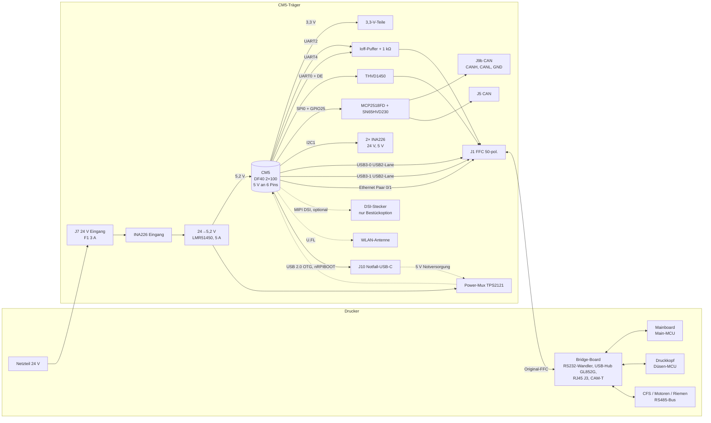

# K2-Pi-CM5-Träger – Konzept „Weg B“ (23.10.2026)

> **Status: KONZEPT, kein Layout, nicht bestellen.** Eigene Trägerplatine für das Raspberry Pi Compute Module 5
> (CM5) am Platz der T113-Platine (Upper-Board) des K2 Plus. Sie ersetzt CM5-IO-Board, Stapelleiste, USB-RS485-Adapter,
> Pi-Netzteil und alle Zusatzkabel. Einzige Kabel: das **Original-Flachkabel** (FFC 50-pol., 0,5 mm) und eine
> **24-V-Zuleitung**.
>
> Bewertung je Aussage: **B** = belegt (Datenblatt/Messung), **V** = vermutet (starke Indizien), **ANNAHME** = ungeprüft.

Quellen: Raspberry Pi „Compute Module 5 Datasheet“ (Stand 8. Juni 2026, im Folgenden **DS**), eigene Messungen
([`PI-ANSCHLUSS-LOWERBOARD.md`](../../PI-ANSCHLUSS-LOWERBOARD.md) §8, Messwerte vom 23.10.2026), Entwurf 3 der
Vorgängerplatine K2-Pi-Basis V1.5 (nicht in diesem Repo; im Folgenden „V1.5“).

---

## 0. Randbedingungen

| Punkt | Wert | Bewertung |
|---|---|---|
| Freie Höhe über der Auflage-Ebene am T113-Platz | **15,55 mm** gemessen (A3, Karton evtl. nicht abgezogen) → **Planung mit 14 mm** | B (Messung), Abzug ANNAHME |
| Luft unter der Platine | **2,45 mm** (A2.5) → Bauteile Unterseite **≤ 2,0 mm** | B |
| Umriss | V1.5: 80 × 56,1 mm, Lochbild L1 (8,80 \| 4,15), L2 (76,90 \| 4,21), L3 (3,01 \| 53,49), L4 (63,41 \| 53,41) | B (Schablone) |
| Verlängerung | **+10 mm Richtung Bridge-Board** erlaubt | B (Vorgabe) |
| „Richtung Bridge-Board“ | = Seite, an der das Original-FFC abgeht (J1, linke Kante in V1.5-Koordinaten) → **neuer Umriss ≈ 90 × 56,1 mm, x −10 … 80** | **ANNAHME** (am Gerät bestätigen) |
| Kabel | nur Original-FFC (J1) + 24 V (J7). **Kein zusätzliches USB-Kabel.** | B (Vorgabe) |
| CM5 | vorhanden: CM5 Rev 1.0, 4 GB RAM, 64 GB eMMC, WLAN/BT | B (live ausgelesen) |
| Flashen | weiter über das CM5-IO-Board (CM5 umstecken) – auf dem Träger nur Testpunkte | B (Vorgabe) |

---

## 1. Blockschaltbild und Funktionen



| Funktion | Weg | gegenüber IO-Board-Lösung |
|---|---|---|
| Haupt-MCU (UART4) / Düsen-MCU (UART2) | CM5-GPIO → Ioff-Puffer → 1 kΩ → J1 (FFC 30/32 bzw. 26/28) | unverändert, zusätzlich Rückspeiseschutz |
| RS485 (CFS, Motor-Parameter, Riemen) | UART0 + DE (GPIO17) → THVD1450 → J1 (FFC 19 = B, 20 = A) | **USB-RS485-Adapter entfällt** |
| CAN (späteres Toolhead-Board) | SPI0 + GPIO25 → MCP2518FD → SN65HVD230 → J5 (nur CAN) und J9 | wie Entwurf 3 |
| ~~24 V für ein CAN-Toolhead~~ (**entfallen mit Weg A 24.10.2026**) | ~~J7 → eFuse → J9~~ – der Toolhead bekommt seine 24 V **direkt vom Drucker-Netzteil** (eigene Kabelsicherung ≈ 5 A); CAN über **J9b** | siehe §7.4 und „Entscheidungen des Nutzers“ |
| Kamera (CAM-T) | **USB3-0, USB2-Lane** → J1 (FFC 37/38) | **kein USB-Kabel**, saubere 90-Ω-Leiterbahn |
| USB-Hub des Bridge-Boards (J18 hinten, Toolhead-USB, J8/CAM-X) | **USB3-1, USB2-Lane** → J1 (FFC 34/35) | **kein USB-Kabel** |
| Netzwerk | CM5-PHY → J1 (FFC 1/2, 4/5) → **Original-RJ45 J3** am Bridge-Board | Original-Buchse wieder nutzbar (100 Mbit/s, ANNAHME) |
| Versorgung | 24 V (J7) → 5,2 V/5 A → CM5 | **Pi-Netzteil entfällt** |
| Strom-/Spannungsmessung | INA226 an 24-V-Eingang und CM5-5V | wie Entwurf 3 |
| WLAN/BT | CM5 intern, Antenne über U.FL | wie bisher |
| **Notfall-USB-C** (neu) | J10 USB-C (USB 2.0) am rpiboot-/OTG-Port des CM5 + Taster nRPIBOOT; optional 5-V-Notversorgung über Power-Mux | Rettung/Flashen **ohne Ausbau des CM5**; normales Flashen weiter am IO-Board, siehe §7.5 |
| Display | **nur Bestückoption** (DSI-Stecker), siehe §7.2 | Original-Display bleibt vorerst ohne Funktion (wie heute) |
| Entfällt | IO-Board, Stapelleiste, HAT-EEPROM, Ideal-Diode, J6 (USB-Stiftleiste), Rückfall-Umschaltung RS485 | – |

---

## 2. CM5-Pinbelegung, die genutzt wird

Pin-Nummern nach DS §4.2 (Steckverbinder A = Pins 1–100, B = 101–200). GPIO_VREF an CM5_3.3V → alle GPIO 3,3 V (B).

### 2.1 Versorgung und Steuerung

| CM5-Pin | Signal | Ziel / Beschaltung | Bewertung |
|---|---|---|---|
| 77, 79, 81, 83, 85, 87 | 5V (Input), 4,75–5,25 V | Wandler-Ausgang 5,2 V, **alle 6 Pins** breit angebunden | B (DS) |
| alle GND-Pins | GND | durchgehende GND-Lage L2 | B |
| 78 | GPIO_VREF | an CM5_3.3V (84/86) | B (DS: „must be connected“) |
| 84, 86 | CM5_3.3V (Output), max. 300 mA/Pin, 600 mA gesamt | 3,3-V-Teile auf dem Träger (Bedarf ≈ 50 mA) | B |
| 88, 90 | CM5_1.8V | unbenutzt | – |
| 99 | PMIC_Enable (100 kΩ Pull-up auf 5 V intern) | Testpunkt, sonst offen | B |
| 92 | PWR_Button | Testpunkt + optionaler Taster (Bestückoption) | B |
| 93 | nRPIBOOT | Testpunkt (Flashen erfolgt am IO-Board) | B |
| 20 | EEPROM_nWP | offen (intern 100 kΩ Pull-up) | B |
| 76 | VBAT (2,5–3,5 V) | optionaler 2-pol. Stecker für CR2032 mit Kabel (Bestückoption) | B |
| 21 | LED_nACT (5-V-tolerant, 20 mA) | grüne LED | B |
| 95 | LED_nPWR (braucht Puffer) | rote LED über Transistor (Bestückoption) | B |
| 19 / 16 | Fan_PWM (Open Drain) / Fan_Tacho | optionaler Lüfterstecker (Bestückoption, siehe §3.3) | B |
| 89 / 91 | WL_nDisable / BT_nDisable | offen (= an) | B |
| 94 / 96 | CC1 / CC2 | an die **Notfall-USB-C-Buchse J10** (wie am IO-Board, CM5 handelt 5 V/5 A selbst aus). Im Normalbetrieb (nur 24 V) ohne Gegenstelle → CM5 nimmt 3 A an → `usb_max_current_enable=1` + `PSU_MAX_CURRENT=5000` im Bootloader-EEPROM (wie Entwurf 3) | B (DS), Software-Folge V |
| 103 / 105 | USB_N / USB_P (USB 2.0, dwc2/OTG – der **rpiboot-Port**, DS: nRPIBOOT bootet „through USB 2.0“) | → USBLC6-2SC6 → **J10 USB-C** D−/D+ (nur ein Steckerseiten-Paar, A6/A7 und B6/B7 parallel) | B |
| 101 | USB_OTG_ID (intern Pull-up; GND = Host) | **offen** → CM5 ist Gerät (rpiboot, USB-Gadget) | B |
| 93 | nRPIBOOT | zusätzlich **Taster „RPIBOOT“** nach GND (gedrückt halten beim Einstecken/Einschalten) | B |

### 2.2 Schnittstellen

| CM5-Pin | GPIO / Signal | Funktion | Ziel |
|---|---|---|---|
| 54 | GPIO4 | UART2 TX | → Ioff-Puffer → 1 kΩ → FFC 26 (Düsen-MCU) |
| 34 | GPIO5 | UART2 RX | ← 1 kΩ ← Ioff-Puffer ← FFC 28 |
| 31 | GPIO12 | UART4 TX | → FFC 30 (Haupt-MCU) |
| 28 | GPIO13 | UART4 RX | ← FFC 32 |
| 55 | GPIO14 | UART0 TX | → THVD1450 DI |
| 51 | GPIO15 | UART0 RX | ← THVD1450 RO |
| 50 | GPIO17 | UART0 RTS (DE/nRE) | → THVD1450 DE/nRE (Kernel-RS485-Modus) |
| 44 / 40 / 38 / 39 | GPIO10 / 9 / 11 / 8 | SPI0 MOSI / MISO / SCLK / CE0 | MCP2518FD |
| 41 | GPIO25 | CAN-Interrupt | MCP2518FD nINT |
| 58 / 56 | GPIO2 / GPIO3 | I2C1 SDA / SCL (intern 1,8 kΩ Pull-up) | 2× INA226 (0x40 Eingang 24 V, 0x41 CM5-5V; 0x44 Toolhead entfallen mit Weg A) – keine externen Pull-ups |
| 30 | GPIO6 | **frei** (seit Weg A 24.10.2026; vorher Toolhead-eFuse-Abschaltung) | – |
| 134 / 136 | USB3-0-DP / DM | USB 2.0 der Port-0-Buchse | FFC 38 (DP) / 37 (DM) → Kamera CAM-T |
| 163 / 165 | USB3-1-DP / DM | USB 2.0 der Port-1-Buchse | FFC 35 (DP0) / 34 (DM0) → Hub GL852G |
| 12 / 10 | Ethernet_Pair0_P / N | MDI-Paar 0 | FFC-Paar 1/2 (siehe §6) |
| 4 / 6 | Ethernet_Pair1_P / N | MDI-Paar 1 | FFC-Paar 4/5 |
| 11/9, 3/5 | Ethernet_Pair2/3 | unbenutzt (nur 2 Paare zur Buchse) | offen |
| 15 / 17 | Ethernet_nLED3 / nLED2 | Link/Aktivität | LEDs auf dem Träger (die LEDs der Bridge-Buchse sind am FFC nicht belegt, V) |
| 115–141 / 175–… | MIPI0 / MIPI1 | DSI-Option | siehe §7.2 |
| 128–142, 157–171 (RX/TX) | USB 3.0 SuperSpeed | unbenutzt | – |
| 103 / 105, 101 | USB_N / USB_P (dwc2), USB_OTG_ID | **Notfall-USB-C J10** (rpiboot, USB-Gadget) | siehe §2.1 und §7.5 |
| 102–124 | PCIe | unbenutzt | – |

- **USB 2.0: P und N dürfen nicht vertauscht werden** (DS §2.4); 90 Ω differenziell, Längenabgleich im Paar ≤ 0,15 mm (B).
- Beide Ports laufen über den RP1-xHCI-Controller wie am IO-Board (dort: RS485-Adapter an Bus 2, Hub an Bus 4) (B, live).
- Freie GPIO-Reserve: GPIO6, 16, 18–24, 26 (Testpunkte für spätere Erweiterungen); GPIO27 ist seit 24.10.2026 PWR_FAIL_N,
  GPIO6/GPIO26 sind mit Weg A (Toolhead-eFuse entfallen) wieder frei.

### 2.3 Belegung des FFC J1 (übernommen, unverändert gegenüber V1.5)

| FFC-Pin | Signal | Bewertung |
|---|---|---|
| 1/2, 4/5 | Ethernet (zur RJ45 J3 am Bridge-Board) | B (Durchgang 21.10.) |
| 19 / 20 | RS485 B / A | B |
| 26 / 28 | Düsen-MCU TX→ / ←RX (TTL 3,3 V) | B (live) |
| 30 / 32 | Haupt-MCU TX→ / ←RX | B (live) |
| 34 / 35 | Hub-USB DM0 / DP0 | B |
| 37 / 38 | Kamera-USB DM / DP | B |
| 3, 6, 16, 18, 21, 23, 25, 27, 29, 31, 33, 36, 39–44 | GND | B |
| 45–50 | 5 V des Bridge-Boards (**nie mit CM5-5V verbinden**, nur LED „Drucker 5 V“ + Messung) | B |
| 11, 12, 14, 15, 17 (≈ 5 V Signal) | nicht anschließen | B |
| 7, 8, 9 (SD), 10, 13, 22, 24 | offen bzw. nur Testpunkt | V |

---

## 3. Mechanik

### 3.1 Umriss und Lage

```
 y=56,1 ┌──────────────────────────────────────────────────────────┐ x=80
        │L3                                        L4              │
        │      ┌───────────────── CM5 55 × 40 ──────────┐          │
   J1   │      │  Steckverbinder A (Pins 1–100)          │  rechter │
  FFC   │      │                                        │  Streifen│
 x=−10  │ ESD  │  SoC + Kühlkörper                      │  19 mm:  │
 Kante  │ USB  │                                        │  Wandler,│
        │ Eth  │  Steckverbinder B (Pins 101–200)        │  J7, J5, │
        │      └────────────────────────────────────────┘  RS485   │
        │L1  (Unterseite: CAN, INA226, Puffer, Kleinteile ≤ 2 mm) L2│
 y=0    └──────────────────────────────────────────────────────────┘
        x=−10        x≈5                              x≈60        x=80
```

| Punkt | Planung | Bewertung |
|---|---|---|
| Umriss | 90 × 56,1 mm (x −10 … 80), Ecken R2 | ANNAHME (Richtung bestätigen) |
| J1 | an der neuen linken Kante x ≈ −10, Körper y ≈ 18,6 … 47,1 (Lage wie V1.5, nur 10 mm versetzt) | V (CON2-Lage aus Foto, A1 noch messen) |
| CM5 | etwa x 5 … 60, y 8 … 48; frei von L1 (8,80 \| 4,15) und L4 (63,41 \| 53,41) einschl. Schraubenkopf Ø 5,5 mm | V – genaue Lage der Steckverbinder aus den offiziellen CM5-Designdaten übernehmen |
| CM5-Befestigung | 4× M2,5 (3,5 mm vom Modulrand), Abstandshalter 1,5 mm bzw. Gewindeeinsätze | B (DS) |
| Ausrichtung CM5 | Ethernet-Pins (1–12, Steckverbinder A) und USB-Pins (134/136, 163/165, Steckverbinder B) möglichst nah an J1 → Modul so drehen, dass die Pin-1-Seite zur J1-Kante zeigt | V |
| Antenne | Antennenende des CM5 zu einer Platinenkante; bei interner Antenne Kupfer-Aussparung ≥ 8 × 15 mm unter der Antenne | B (DS §4.1.2) |
| Rechter Streifen (x 60 … 80) | 24→5-V-Wandler mit Spule (3 mm) oben, **J7 (24 V Eingang, XT30 liegend)**, **J9 (Toolhead, Micro-Fit 3.0 2×2 liegend)**, J5 (CAN-Stiftleiste, optional), eFuse, J3 (RS485-Messabgriff); 24-V-Pfad J7 → eFuse → J9 kurz an der rechten Kante, **weg vom CM5** | V |
| Stecker-Höhen | XT30PW (liegend) ≈ 8 mm, Micro-Fit 3.0 2×2 liegend ≈ 10 mm → + 1,6 mm Platine ≤ 12 mm ✓ (unter 14 mm) | ANNAHME (Datenblattwerte im Layout prüfen) |
| Unterseite | CAN, INA226, Puffer, ESD, Widerstände – **alles ≤ 2,0 mm** | B (A2.5 = 2,45 mm) |
| Oberseite unter dem CM5 | **bauteilfrei** (bei 1,5 mm Stapelhöhe liegt das Modul ohne Luft auf), Kupfer und Vias erlaubt | B (DS: „no clearance underneath“) |

### 3.2 Höhenbudget (über der Auflage-Ebene)

| Teil | 1,5-mm-Steckverbinder (empfohlen) | 4,0-mm-Steckverbinder |
|---|---|---|
| Trägerplatine | 1,6 mm | 1,6 mm |
| CM5 montiert (Steckverbinder + Modul-PCB 1,24 + SoC 2,2) | 4,94 mm (B, DS) | 7,44 mm (B, DS) |
| Wärmeleitpad | 0,5–1,0 mm | 0,5–1,0 mm |
| Kühlkörper flach | ≤ 5,0 mm | ≤ 3,0 mm |
| **Summe** | **12,0–12,5 mm** | 12,5–13,0 mm (Kühlkörper zu flach für Dauerlast) |
| Reserve bis 14 mm | **1,5–2,0 mm** ✓ | 1,0–1,5 mm |
| Höchste Bauteile außerhalb des CM5 | J7 (JST PH liegend) 4,8 mm + 1,6 = 6,4 mm; Spule 3 mm + 1,6 = 4,6 mm ✓ | – |

**Ergebnis:** Mit dem **1,5-mm-Steckverbinder** (Amphenol 10164227-1001A1RLF, DS) und einem Kühlkörper bis 5 mm passt
der Träger sicher in 14 mm (V – gilt, wenn A3 inkl. Karton gemessen wurde; bei A3 = 15,55 mm netto bleibt mehr Reserve).

### 3.3 Kühlung

- Ohne Lüfter: Aluminium-Kühlkörper ca. 40 × 40 × 5 mm auf SoC (und RAM/PMIC, falls im Kontaktbereich), Wärmeleitpad
  0,5–1 mm. Klipper-Last ist gering (DS: typisch 0,9 A Betrieb), der SoC drosselt ab 85 °C selbst (B, DS §4.4).
- Display-Einheit ist geschlossen, Umgebung beim Drucken mit Kammerheizung ggf. 40–60 °C (ANNAHME) → Temperatur im
  Betrieb überwachen (`vcgencmd measure_temp`), Option: 30-mm-Lüfter (5 V, Fan_PWM) nur, wenn Platz (Höhe!) da ist.

---

## 4. Lagenaufbau und Impedanzen

| Lage | Nutzung |
|---|---|
| L1 (oben) | CM5-Steckverbinder, Wandler, schnelle Paare (USB, Ethernet) |
| L2 | **durchgehende GND-Fläche** (Bezug für alle Paare auf L1) |
| L3 | 5,2-V-Fläche für den CM5 (6 Pins), 3,3 V, ggf. GND |
| L4 (unten) | Kleinsignal, Unterseiten-Bauteile, GND-Flächen |

- Vorschlag JLC **JLC04161H-7628** (1,6 mm, 4-lagig, Prepreg L1–L2 ≈ 0,21 mm) – Impedanzkontrolle bei JLC ohne Aufpreis
  für 4 Lagen (V).
- **USB 2.0: 90 Ω differenziell**, **Ethernet: 100 Ω differenziell**, Längenabgleich im Paar ≤ 0,15 mm (B, DS).
- Leiterbahnbreite/-abstand **mit dem JLC-Impedanzrechner für den gewählten Aufbau bestimmen** – Richtwerte bei
  7628/1 oz außen: 90 Ω ≈ 0,20 mm Bahn / 0,20 mm Abstand, 100 Ω ≈ 0,15 mm / 0,20 mm (ANNAHME, nicht gerechnet).
- Paare ohne Lagenwechsel; falls nötig, GND-Vias neben jedem Signal-Via.
- Kritischer Abschnitt ist nicht die Platine, sondern das **FFC (4,6 cm) und das Bridge-Board** – die Original-T113
  betrieb Kamera-USB und Ethernet über genau diesen Weg (V: Hersteller-Design, also tauglich).

---

## 5. Stückliste (Entwurf) und Kosten

| Teil | Typ | LCSC | Bewertung |
|---|---|---|---|
| CM5-Steckverbinder ×2 | Amphenol 10164227-1001A1RLF (1,5 mm) bzw. kompatibel Hirose DF40C-100DS-0.4V(51) | **vor Bestellung prüfen** | ANNAHME (Verfügbarkeit) |
| 24→5,2-V-Wandler | LMR51450SDRRR, 5 A | C6890985 | B (aus Entwurf 3) |
| Spule | FXL0630-4R7-M, 4,7 µH, 3 mm | C167220 | B (E3) |
| TVS 24 V | SMFJ28A | C5439963 | B (E3) |
| Shunts | 10 mΩ 2512 | C323772 | B (E3) |
| Strommesser ×2 | INA226AIDGSR | C49851 | B (E3) |
| RS485 | THVD1450DR | C2671361 | B (E3) |
| RS485-TVS | SM712 | C502564 | B (E3) |
| CAN-Controller | MCP2518FDT-H/SL | C626759 | B (E3) |
| CAN-Transceiver | SN65HVD230DR | C12084 | B (E3) |
| Quarz 40 MHz | JGHC S3240000151040 | C426990 | B (E3) |
| CAN-ESD | NUP2105LT1G | C14486 | B (E3) |
| USB-ESD ×2 | USBLC6-2SC6 (VBUS-Pin an CM5-3,3V bzw. offen – im Layout klären) | C7519 | B (Teil), Beschaltung V |
| Ethernet-ESD | z. B. TPD4E05U06 oder RClamp0524 | **offen** | ANNAHME |
| Ioff-Puffer UART-RX | 2× SN74LVC1G125 (Ioff, 3,3 V vom CM5) | **offen** | V (Schaltung), ANNAHME (Nr.) |
| UART-ESD | SRV05-4 | C5240367 | B (E3) |
| 24-V-Eingang J7 | **XT30PW-M** (liegend, ≈ 15 A) statt JST PH (≈ 2 A, reicht mit Toolhead nicht) | **vor Bestellung prüfen** | ANNAHME (Nr.) |
| Toolhead-Stecker J9 | **Molex Micro-Fit 3.0 2×2 liegend** (z. B. 43045-0412, bis ≈ 5–6 A je Kontakt mit 18 AWG) – Belegung wie gängige CAN-Toolheads (24 V, GND, CANH, CANL); Alternative XT30(2+2) | **vor Bestellung prüfen** | ANNAHME (Nr., Belegung gegen das gewählte Toolhead-Board prüfen) |
| eFuse Toolhead | z. B. **TPS1663x** (4,5–60 V, bis 6 A, einstellbare Strombegrenzung, EN, IMON) | **vor Bestellung prüfen** | V (Typ), ANNAHME (Nr.) |
| TVS Toolhead-Ausgang | SMFJ28A (wie Eingang) | C5439963 | B (Teil) |
| Notfall-USB-C J10 | USB-C-Buchse **Mid-Mount** (Bauhöhe über Platine ≤ 3,5 mm), 16-pol. USB-2.0-Typ | **vor Bestellung prüfen** | ANNAHME (Nr.) |
| USB-ESD J10 | USBLC6-2SC6 | C7519 | B (Teil) |
| 5-V-Power-Mux (nur bei Notversorgung) | z. B. **TPS2121** (2,8–22 V, 4,5 A, Prioritätsquelle = 24→5-V-Wandler) | **vor Bestellung prüfen** | V (Typ), ANNAHME (Nr.) |
| Taster RPIBOOT | SMD-Taster flach (≤ 2 mm) | **offen** | ANNAHME |
| 3. Strommesser | INA226AIDGSR (0x44) + Shunt 10 mΩ 2512 | C49851 / C323772 | B (Teile) |
| Eingangs-Shunt | **5 mΩ** 2512 statt 10 mΩ (INA226-Bereich ±81,92 mV → bis ≈ 16 A) | **vor Bestellung prüfen** | V |
| Sicherungen F1/F2, Kleinteile | 1206/0805 | teils offen | ANNAHME |
| Kühlkörper | 40 × 40 × ≤ 5 mm, Wärmeleitpad | Zukauf | – |
| WLAN-Antenne | Raspberry-Pi-Antennenkit (U.FL) oder Original-Antenne der T113, falls U.FL/IPEX | Zukauf | §7.3 |

**Kostenschätzung** (2 fertig bestückte Platinen bei JLC, Preisstand grob 2026, nicht tagesaktuell): Leiterplatte 4-lagig
5 Stück 15–30 €, Bestückung beidseitig inkl. Feinstraster-Steckverbinder 60–90 €, Bauteile 2 × 25–35 €, Versand 15–25 €,
EUSt 19 % → **≈ 150–250 €**, dazu Kühlkörper/Antenne/Kabel 15–30 €. ~~Toolhead-Ausgang (eFuse, Micro-Fit,
3. INA226, TVS) zusätzlich ≈ 5–10 € je Platine~~ (entfällt mit Weg A; aktuelle Schätzung im README); 24-V-Zuleitung 18 AWG mit XT30 ≈ 5–10 €. CM5 wird weiterverwendet. **Reserve für eine zweite
Runde einplanen** (ANNAHME: Feinstraster-Steckverbinder und Ethernet sind die Hauptrisiken).

---

## 6. Ethernet über die Original-Buchse

| Frage | Stand | Bewertung |
|---|---|---|
| Wie viele Paare gehen zur Buchse? | 2 Paare (FFC 1/2 ↔ J3-3/6, FFC 4/5 ↔ J3-7/8, eigene Zählung) | B (Durchgang) |
| Geschwindigkeit | 2 Paare → **100BASE-TX**. Der CM5-PHY (BCM54210PE, Gigabit) muss herunterschalten; sicher per `ethtool -s eth0 advertise 0x008` (100 Mbit/s Vollduplex) | V (Downshift), Software-Rückfall B |
| Vertauschte Paare / Polarität | PHY korrigiert MDI-Kreuzung und Paar-Polarität automatisch | B (DS §2.2) |
| Wo sitzen die Übertrager? | J3 hat 8 Signal-Lötstifte + 4 LED-Stifte, J3-1/2/4/5 ohne Verbindung zum FFC → vermutlich **MagJack** mit Mittelanzapfungen auf dem Bridge-Board | V |
| Was muss auf den Träger? | Bei MagJack am Bridge-Board: **keine Übertrager**, nur 100-Ω-Paare + ESD; Mittelanzapfungen bleiben auf dem Bridge-Board | V |
| Risiko | Der T113-PHY war ein 10/100-PHY; ob die Mittelanzapfungen am Bridge-Board für einen Spannungs-PHY (Broadcom) passend beschaltet sind (Kondensator nach GND vs. Vorspannung), ist **ungeprüft** | ANNAHME → Messung M3 |
| Plan B | WLAN des CM5 (wie heute) – Ethernet ist für Klipper nicht nötig | B |

---

## 7. Optionen und Bewertungen

### 7.1 HAT-EEPROM, Ideal-Diode, RS485-Rückfall
- **HAT-EEPROM entfällt:** Ein Träger ist kein HAT; Overlays (UART0 RS485, mcp251xfd, INA226) stehen dauerhaft in
  `config.txt` auf dem eMMC (B).
- **Ideal-Diode wie in Entwurf 3 entfällt;** wird die Notfall-USB-C-Buchse auch zur Versorgung genutzt, ersetzt sie ein
  **Power-Mux** (§7.5). Verpolschutz bleibt wie Entwurf 3
  (verpolsicherer Stecker J7, Sicherung auch in der GND-Rückleitung, TVS) – wichtig, weil GND über das FFC bereits mit dem
  Netzteil-Minus verbunden ist (B).
- **RS485-Rückfall auf externen Adapter entfällt** (bräuchte ein USB-Kabel); J3 bleibt als 3-pol. **Messabgriff**
  (A, B, GND) für Logikanalysator.

### 7.2 Display (Original hängt über ein eigenes FFC an der T113)
- Das Original-Display ist **nicht** über das Bridge-FFC angebunden, sondern über ein **eigenes FFC direkt an der T113**
  (B, Sichtbefund + Aufbau-Skizze PI-ANSCHLUSS-LOWERBOARD.md §1). Schnittstelle **unbekannt** (ANNAHME: RGB-Parallel oder
  MIPI-DSI; T113-i kann beides).
- **Option „DSI-Stecker für den CM5“** (Bestückoption, 22-pol. 0,5 mm wie Raspberry Pi 5):
  - **Bedingungen:** (1) Panel ist **MIPI-DSI**; (2) Panel-Treiber-IC + Initialisierung bekannt (Datenblatt oder
    Linux-Treiber), (3) Touch-Controller per I2C (z. B. GT911) mit bekannter Adresse, (4) Hintergrundbeleuchtung: wo sitzt
    der LED-Treiber (auf der T113-Platine → muss auf den Träger), (5) Stecker-/Pinbelegung des Display-FFC passt oder ein
    Adapter ist möglich, (6) Platz für den Stecker in der zusätzlichen 10-mm-Fläche.
  - Ist das Panel **RGB-Parallel**: am CM5 nur über DPI auf GPIO0–27 möglich – diese GPIOs sind durch UART/SPI/I2C belegt
    → **nicht machbar** ohne Umbau (ANNAHME).
  - Alternative ohne Stock-Panel: offizielles Raspberry-Pi-DSI-Display im Gehäuseausschnitt + KlipperScreen.
- **Empfehlung:** In Entwurf 1 des Trägers nur **Platz + Footprint** für einen DSI-Stecker an MIPI0 vorsehen (unbestückt),
  Entscheidung nach den Fotos (Messung M5).

### 7.3 WLAN-Antenne
- CM5-PCB-Antenne braucht ≥ 10 mm Abstand zu Metall und eine Kupfer-Aussparung ≥ 8 × 15 mm darunter (B, DS); in der
  Display-Einheit (Metall in der Nähe? ANNAHME) unsicher.
- **Empfehlung: externe Antenne über U.FL** (`dtparam=ant2`), entweder Raspberry-Pi-Antennenkit oder – falls die
  Original-WLAN-Antenne der T113 (AP6256) einen U.FL/IPEX-MHF1-Stecker hat – diese weiterverwenden (Messung M6).

### 7.4 24-V-Ausgang für ein CAN-Toolhead – ÜBERHOLT durch Weg A (24.10.2026)

> **Weg A (Entscheidung 24.10.2026):** J9, die eFuse (TPS26632 mit GPIO6/GPIO26), der INA226 0x44 samt Shunt und der
> 24-V-Stamm quer über die Platine **entfallen**. Der Toolhead bekommt seine 24 V **direkt vom Drucker-Netzteil** mit
> eigener **Kabelsicherung ≈ 5 A**; CAN läuft über **J9b** (JST GH stehend, CANH/CANL/GND), Transceiver und Abschluss-Jumper
> bleiben. Die folgende Tabelle ist nur noch Hintergrund.

> Ein CAN-Toolhead **ersetzt die Original-Düsen-MCU mit PrTouch, Kopf-Filamentsensor, Schneidhebel-Sensor und LIS2DW**
> (frühere Bewertung: Heizung/Lüfter/Sensoren lassen sich abbilden, **PrTouch nicht** – eine andere Z-Sonde wäre nötig).
> Der Ausgang ist deshalb **ab Werk ohne Funktion**, bis ein solcher Umbau erfolgt.

| Punkt | Planung | Bewertung |
|---|---|---|
| Stecker J9 | kombiniert **24 V, GND, CANH, CANL** wie gängige CAN-Toolheads (BTT EBB36/42, SB2209: Micro-Fit 3.0 2×2 bzw. XT30(2+2)); Vorschlag **Micro-Fit 3.0 2×2 liegend** an der rechten Kante. J5 (CAN-Stiftleiste) bleibt als Alternative | V (Typ); **Belegung am gewählten Toolhead-Board prüfen** |
| Leistungsbudget Toolhead | Heizpatrone 60 W (2,5 A) + Extruder-Motor + Lüfter → **≈ 4–5 A Spitze** | V (typische Werte) |
| Leistungsbudget gesamt (24 V) | CM5-Zweig 5,2 V × 5 A / 0,9 ≈ 1,2 A + Toolhead 5 A → **≈ 6–7 A**, Auslegung des Eingangs auf **≥ 8–10 A** | V |
| 24-V-Eingang J7 | **XT30** (liegend) statt JST PH (≈ 2 A) | V |
| Zuleitung | **18 AWG (0,75–1 mm²)** bis ≈ 1 m, darüber **16 AWG (1,5 mm²)**; vom **Netzteil** (freie Klemme bzw. Y-Abzweig am Netzteil), **nicht** vom kleinen „24V +“-Stecker des Bridge-Boards (für ≈ 8–10 A nicht ausgelegt, ANNAHME) | V |
| Kupfer | 24-V-Pfad als Fläche auf L1 **und** L4 (bzw. L3), je ≥ 4 mm breit, viele Vias; kurz an der rechten Kante J7 → Shunt → eFuse → J9, **nicht** unter dem CM5 | V (Faustwerte 1 oz außen, ≈ 10 K Erwärmung bei 10 A, im Layout rechnen) |
| Absicherung | **eFuse 5–6 A** (z. B. TPS1663x: einstellbare Strombegrenzung, Unterspannungsabschaltung, Kurzschlussschutz), getrennt vom 5-V-Zweig des CM5; TVS am Ausgang | V |
| Schaltbar | eFuse-EN über Transistor an **GPIO6**; Pull-up → **Standard EIN** (auch beim Booten). Die Software kann den Toolhead abschalten (Not-Halt, Wartung), z. B. per Moonraker-`[power]`-Gerät (GPIO) | V; Nutzen: Toolhead-Heizung beim Not-Halt sicher stromlos, Aufwand gering (1 Transistor, 2 Widerstände) |
| Strommessung | **3. INA226 (0x44)** direkt am Toolhead-Ausgang (10 mΩ, bis ≈ 8 A), Eingangs-INA226 mit **5 mΩ** (bis ≈ 16 A). Toolhead-Strom aus Eingang minus CM5-Zweig zu rechnen wäre ungenau (Wandler-Wirkungsgrad) | V |
| Rückwirkung | Toolhead-Abschaltung oder Kurzschluss darf den CM5 nicht stören: eFuse begrenzt, Eingangskondensatoren puffern, Wandler-UVLO unter dem eFuse-Abschaltpunkt | V |

### 7.5 Notfall-USB-C

- **Daten:** USB-C J10 an den **USB-2.0-OTG-Port** des CM5 (Pins 103/105) – das ist der Port, über den der CM5 mit
  **nRPIBOOT** per `rpiboot`/`usbboot` als Massenspeicher erscheint (B, DS §2.12.2). Kamera und Bridge-Hub liegen auf den
  USB2-Lanes von USB3-0/USB3-1 und bleiben davon unberührt (B).
- **Taster „RPIBOOT“** (nRPIBOOT nach GND): beim Anlegen der Versorgung gedrückt halten → Flashen/Retten ohne Ausbau.
  Alternativ Lötbrücke. Normales Flashen weiter am IO-Board.
- **USB-Gadget** (Netzwerk/serielle Konsole über USB) im Linux-Betrieb möglich: `dtoverlay=dwc2,dr_mode=peripheral` statt
  `host` (V – DS nennt OTG „nicht offiziell dokumentiert, aber von Nutzern erfolgreich genutzt“).
- **5-V-Notversorgung über USB-C (optional, empfohlen):** z. B. CM5 flashen oder Konfiguration retten, ohne dass der Drucker
  läuft. Umsetzung: **Power-Mux TPS2121** (Priorität = 24→5-V-Wandler, Ersatz = USB-C-VBUS, ≥ 3 A reicht für Flash und
  Notbetrieb), damit nie zwei Quellen parallel laufen und **nichts in PC oder Netzteil zurückspeist** (V). CC1/CC2 an die
  CM5-CC-Pins wie am IO-Board (CM5 handelt 5 V aus); Rückfall **5,1 kΩ** nach GND je CC-Leitung, falls die CM5-CC-Logik
  ohne PD-Netzteil nicht anspringt (ANNAHME → im Layout als Bestückoption beide Varianten).
  - Achtung: Bei USB-C-Versorgung sind Toolhead-Ausgang, RS485/CAN-Busse und der Drucker **nicht** versorgt – nur der CM5.
  - Ohne Notversorgung (nur Daten + nRPIBOOT) wäre die Schaltung einfacher, aber Flashen ginge nur bei laufendem Drucker.
- **Bauhöhe:** Mid-Mount-USB-C (≤ 3,5 mm über der Platine) ✓. **Lage:** an einer im eingebauten Zustand **erreichbaren
  Kante** – ob es eine solche Kante gibt (Gehäuseöffnung?), ist offen → Messung M11.
- **ESD:** USBLC6-2SC6 an D+/D−, TVS an VBUS (z. B. SMF5.0A, ANNAHME).

### 7.6 Rückspeisung in den CM5
- DS: „No pins should be powered before the 5 V rail is active“ (B). Das Bridge-Board legt bei laufendem Drucker 3,3 V auf
  die UART-RX-Leitungen (FFC 28, 32 – gemessen), auch wenn der CM5 heruntergefahren ist (B).
- Deshalb **Ioff-Puffer** (z. B. SN74LVC1G125, Versorgung CM5_3.3V) in beiden RX-Leitungen + 1 kΩ wie bisher; THVD1450,
  MCP2518FD, INA226 hängen an CM5_3.3V und sind im ausgeschalteten Zustand hochohmig (V, Datenblätter im Layout prüfen).

---

## 8. Offene Fragen und Messungen (priorisiert)

| Nr. | Was | Warum | Priorität |
|---|---|---|---|
| M1 | **Richtung der 10-mm-Verlängerung bestätigen** (Foto von oben mit Bridge-Board und FFC) | Umriss, J1-Lage | **muss** |
| M2 | **A1.6 Pin 1 von CON2** und A1 Lage | Ein verdrehter J1 legt die 5 V des Bridge-Boards (FFC 45–50) auf die Ethernet-Pins des CM5 (FFC 1–6) → Schaden. Spiegelschutz wie bei V1.5 ist hier nicht möglich | **muss** |
| M3 | **RJ45 J3 am Bridge-Board**: Aufdruck/Typ der Buchse (MagJack?), Durchgang J3-1/2/4/5 (Mittelanzapfungen) gegen GND und gegen 3,3 V | Ethernet-Beschaltung | hoch |
| M4 | **A3.0 Kartondicke** und A3.1–A3.4 an allen 4 Stellen | Höhenreserve Kühlkörper | hoch |
| M5 | **Display**: Fotos vom Display-FFC an der T113 (Steckerseite, Polzahl, Aufdruck), Panel-Rückseite (Typenschild), Touch-Controller | DSI-Option | mittel |
| M6 | **WLAN-Antenne der T113**: Steckertyp (U.FL/IPEX?), Kabellänge, Lage im Gehäuse | Antenne | mittel |
| M7 | Neue FFC-Länge: Original 4,6 cm Typ A; durch die Verlängerung ggf. **≈ 3,6 cm** (Typ A, 50-pol., 0,5 mm) oder Schlaufe | Kabel | mittel |
| M8 | Gehäusematerial rund um den T113-Platz (Metall/Kunststoff) | Antenne, Thermik | niedrig |
| M9 | Temperatur in der Display-Einheit bei laufender Kammerheizung | Kühlkörper | niedrig |
| M10 | **24-V-Abgriff für 8–10 A**: Lage des Netzteils, freie Klemmen, Kabelweg zur Display-Einheit, Länge | Zuleitung J7 (18/16 AWG) | hoch (falls Toolhead-Ausgang genutzt wird) |
| M11 | **Ist eine Platinenkante im eingebauten Zustand erreichbar** (für Notfall-USB-C und Taster RPIBOOT)? Ggf. Gehäuseöffnung | Lage J10 | mittel |
| M12 | Kabelweg vom Träger zum Druckkopf für ein späteres CAN-Toolhead (Schleppkette, Länge) | J9-Lage | niedrig (erst beim Umbau) |

**Risiken**

| Risiko | Maßnahme |
|---|---|
| Feinstraster-Steckverbinder (0,4 mm) – Bestückung/Lötqualität | Bestückung durch JLC, Röntgen/AOI-Option, 2 Platinen |
| Verdrehtes FFC zerstört CM5-Ethernet (siehe M2) | M2 vor Bestellung zwingend; Pin-1-Markierung im Siebdruck |
| Ethernet ohne passende Mittelanzapfung am Bridge-Board | M3; Rückfall WLAN |
| USB-Highspeed über FFC + Bridge-Board | Original-Design der T113 nutzt denselben Weg (V) |
| Wärme in der geschlossenen Display-Einheit | Kühlkörper, Temperaturüberwachung, Lüfteroption |
| 24 V mit bis zu 10 A auf dem Träger (Toolhead) | Pfad kurz an der Kante, breites Kupfer auf 2 Lagen, eFuse 5–6 A, XT30; Ausgang ab Werk ungenutzt |
| Notfall-USB-C speist zurück | Power-Mux (keine Parallelschaltung), CC korrekt; ohne Mux nur Datenbetrieb |
| Höhe knapp, falls A3 netto < 13 mm | 1,5-mm-Steckverbinder + flacherer Kühlkörper; sonst CM5 in die Verlängerungsfläche verschieben ist **nicht** möglich (55 mm Modul) → Plan B unten |

---

## 9. Empfehlung

- **Die Höhe reicht** mit 1,5-mm-Steckverbinder und Kühlkörper ≤ 5 mm (≈ 12,0–12,5 mm von 14 mm, V); auch die neuen
  Stecker (XT30 ≈ 8 mm, Micro-Fit ≈ 10 mm, USB-C Mid-Mount ≤ 3,5 mm, jeweils + 1,6 mm Platine) bleiben darunter. Die
  10-mm-Verlängerung Richtung Bridge-Board wird **nicht für die Höhe**, sondern für **J1, ESD, USB-/Ethernet-Führung, die
  DSI-Option und ggf. die Notfall-USB-C-Buchse** gebraucht – damit wird die dichte Fläche um den CM5 entlastet. Der
  24-V-Toolhead-Zweig (J7, eFuse, J9) gehört an die **rechte Kante**, weg vom CM5.
- Fläche wird mit Toolhead-Ausgang, Notfall-USB-C und Power-Mux **knapp**: Unterseite (≤ 2 mm) konsequent für
  Kleinsignal-Teile nutzen; falls es nicht passt, zuerst die DSI-Option und J5 (CAN-Stiftleiste, J9 ersetzt sie) streichen.
- **Plan B**, falls M4 deutlich weniger als 13 mm ergibt: CM5 ohne Kühlkörper-Aufbau mit Wärmeleitpad direkt an ein
  Blech/Gehäuseteil (Wärmeableitung nach oben), oder Verlängerung weiter Richtung Bridge-Board mit kürzerem FFC (Nutzeridee)
  – beides erst nach M1/M4 entscheiden.
- Nächster Schritt nach M1–M4: Entwurf 1 des Trägers (Schaltplan aus Entwurf 3 übernehmen, CM5-Teil nach den offiziellen
  CM5-IO-Board-Designdaten, 4-lagig), danach dieselben Prüfungen wie bei V1.5 (ERC/DRC/Parität, Netzlisten-, Lage-, Höhen-
  und Impedanz-Wächter) und die vollständige Bestell-, Montage- und Inbetriebnahme-Dokumentation.

## Entscheidungen (23.10.2026, nach dem Konzept)

| Punkt | Entscheidung |
|---|---|
| Lage Notfall-USB-C (J10) | an **Kante B nahe Bohrung L1** (Bereich der früheren Messstelle „1b“) |
| Bauform USB-C | **stehend (vertikal)**, Stecker von oben – seitlich ist im Gerät schlecht erreichbar. Bauhöhe der vertikalen Buchse (typ. 7–10 mm) gegen das Höhenbudget von ~14 mm prüfen; zum Einstecken muss das Gehäuse offen sein (Stecker + Knickschutz ragen ~20–30 mm nach oben) – für einen Notfallanschluss akzeptiert. |
| Boot-Auswahl (nRPIBOOT) | Jumper (2 Stifte) statt Taster – flacher, nicht versehentlich auslösbar (Vorschlag, Bestätigung offen) |
| Netzwerk-Übertrager (M3) | **Messung 23.10.2026** (Drucker aus, T113 ausgebaut, Breakout am Original-FFC, Widerstand): Breakout 1↔2 **OL**, 4↔5 **OL** → zwischen den Leitungen eines Paares liegt **keine Übertragerwicklung** → die RJ45 am Bridge-Board ist eine **einfache Buchse ohne Übertrager**; der Übertrager saß auf der T113-Platine (**B**). Folge: Der CM5-Träger braucht einen **eigenen 10/100-Übertrager** (diskret, SMD, Höhe ≤ ~6 mm, z. B. Übertragermodul für 100BASE-TX) samt Mittelanzapfungs-/Bob-Smith-Beschaltung zwischen CM5-MDI (Paar 0/1) und FFC-Pins 1/2 bzw. 4/5. Nebeneffekt: Gleichspannung auf den FFC-Ethernet-Pins (z. B. bei verdrehtem FFC) erreicht den CM5 nicht direkt (Übertrager trennt galvanisch) – M2 bleibt trotzdem Pflicht (5 V auf anderen Signalpins). |
| Übertrager-Beleg (Foto) | Auf der T113-Platine sitzt direkt neben CON2 ein Netzwerk-Übertrager „E-NETTR H1601G“ (10/100) – bestätigt die Messung M3 (**B**). |
| Pin 1 von CON2 (M2) | **Am Bauteil bestätigt (23.10.2026):** Das Pin-1-Dreieck von CON2 sitzt am Ende **neben der Micro-USB-Buchse (Richtung L1, Kante B)**. Zusammen mit den Messungen ergibt sich die **physische Lage** des FFC am T113-Platz: Breakout-Stifte **45–50 (5 V)** liegen am Ende **Richtung L1/Kante B** (bei der Micro-USB-Buchse = CON2-Pin 1), Breakout-Stifte **1–5 (Ethernet)** am Ende **Richtung L3/Kante D** (beim Übertrager H1601G). CON2-Nummer = 51 − Breakout-Nummer (**V**, aus Geometrie: Übertrager am unteren, Versorgung am oberen Ende). Das deckt sich mit der V1.5-Festlegung „J1-Pin 1 (= Breakout 1) zur Unterkante“ – kein Widerspruch. Für J1 auf dem Träger gilt: Signal-Zuordnung nach **Breakout-Nummern**, 5-V-Ende Richtung Kante B. |
| Option Mainboard-Ersatz (M8P) | J9b CAN nur Daten, CAN-Abschluss per Jumper, J11 RS485-Abgriff mit Abschluss-Jumper |
| DSI-Display | DSI-Stecker bestückt, Ziel-Display Waveshare 4.3inch DSI LCD (Rev 2.2 nötig für Pi 5/CM5) |
| Lage DSI-Stecker | **an Kante C** (rechte Kante, zwischen den Bohrungen L2 und L4), dort wo an der T113 der Display-Stecker **CON1** sitzt – **am 23.10.2026 bestätigt** (das Original-Displaykabel geht an der T113 vom rechten Stecker CON1 ab). Stecker senkrecht entlang der Kante, Öffnung zur Kante, Kabel nach außen; Kontaktseite und Pin 1 wie Raspberry Pi 5 / CM-IO-Board (gleicher Hirose FH12-22S-0.5SH wie auf dem CM4-IO-Board), Pi-5-Displaykabel passt ohne Verdrehen. DSI hat an Kante C Vorrang: XT30 (J7) bleibt oben, J12 (DSI) in der Mitte, J9 (Toolhead) darunter; **J9b weicht an Kante B** (neben L1) aus, der CAN-Abschluss-Jumper sitzt unten rechts an Kante D. |
| **24.10.2026: J7/J9 an Kante A wie J1, J9b/J11 stehend, tauschbare Sicherung** | Umgesetzt im Layout (siehe README „Mechanik und Lage“, „24-V-Eingang und tauschbare Sicherung“, „Höhenbilanz“): **J7 (XT30 liegend) an Kante A über J1**, Stecköffnung nach links, Kabel kommt wie das Flachkabel von links; L1 und die Einsteckzone von J1 bleiben frei. **J9 bleibt an Kante C** – unter J1 sind nur 8,2 mm Höhe frei (Micro-Fit-Körper 9,9 mm), über J1 passt nur J7 (+ Sicherung). **J9b (Kante B) und J11 (Kante D) stehend** als JST GH BM03B-GHS-TBT (LCSC C161691); gesteckt mit Kabelbogen ≈ 13,6 mm über der Auflage > 11,5 mm → nur stecken, wenn darüber Platz ist. **Tauschbare Eingangssicherung F1** = Littelfuse 157 0157010.DR (C178831, mit 10-A-Sicherung 453); Ersatz 0451010.MRL (C44479) auf die Einkaufsliste. Die frühere zweite Sicherung F2 (GND-Rückleitung) entfällt: Bei Verpolung fließt der Kurzschlussstrom über D8 ohnehin durch F1; fehlende J7-Masse begrenzt weiter F3 (PTC). Die eFuse für J9 bleibt. 24-V-Pfad: J7 → F1 → D8 → Stamm auf L3 → Shunt R23/INA226 0x40 (rechts oben) → eFuse/Wandler (abweichend von Abschnitt 3.1/7.4: der Pfad ist nicht mehr kurz an einer Kante). |
| **24.10.2026: Weg A** | **J9 entfällt, Toolhead-24-V direkt vom Netzteil (Kabelsicherung 5 A), CAN über J9b; F1 ≈ 3 A.** Umgesetzt: J9, eFuse U9 (+ R32, C23, JP8, Q1, R34, R35, C24), INA226 0x44 U6 (+ R25, R22, C29), C26, TVS D9 entfernt; GPIO6/GPIO26 frei; Shunt R23 + INA226 0x40 sitzen jetzt direkt hinter F1 (links unter J7), der 24-V-Stamm auf L3 führt nur noch zum Wandler; F1 = Littelfuse 0157003.DR (3 A, LCSC C187520). Details README „24-V-Eingang und tauschbare Sicherung“. |
| 24.10.2026: Stromausfall-Erkennung | INA226 0x40 ALERT → PWR_FAIL_N (10 k Pull-up, TP12) → GPIO27 (CM5-Pin 48); Bus-Unterspannungsgrenze per Software (z. B. 20 V). Supercap-Puffer (2 × 10 F, DNP) **nicht umgesetzt** – kein Platz (≥ 31 × 21 mm) und zu hoch (Ø 10 mm liegend + Platine > 11,5 mm), Energie ohne Hochsetzsteller nur ≈ 1,5–2 s (README, Offene Punkte 12). |
